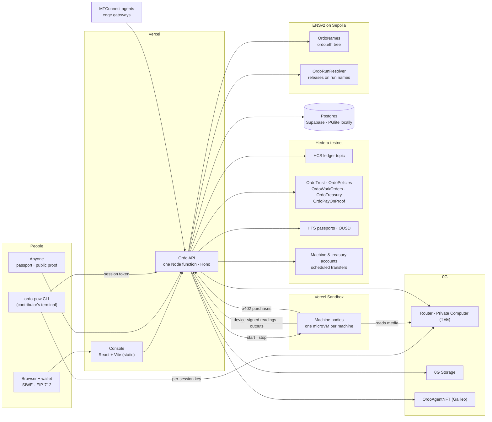
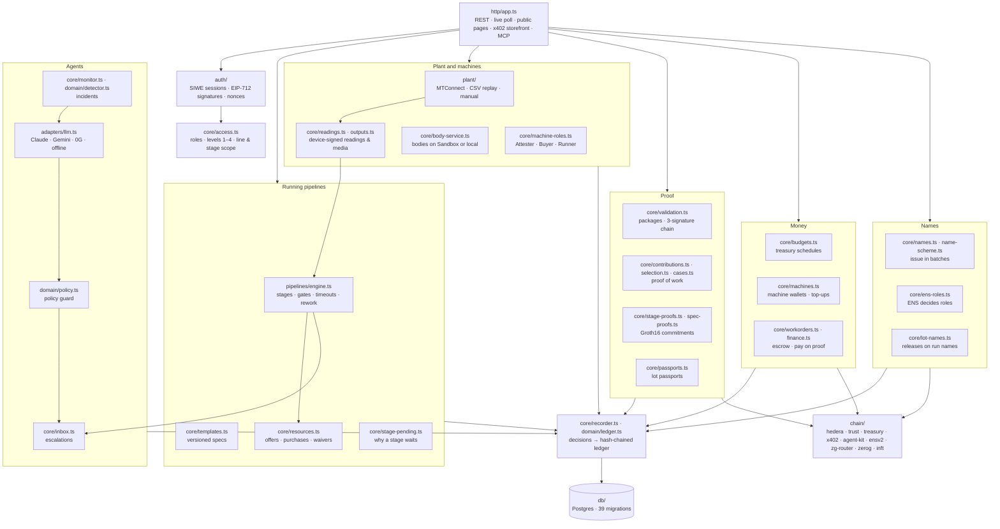
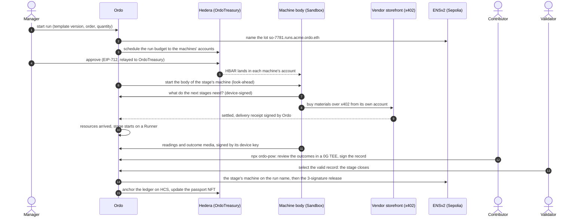

# Ordo: autonomous manufacturing orchestration, with proof

Ordo runs production pipelines across machines, robots and people. Software agents execute each stage from live plant data, escalate what is out of policy, and record every decision with its reason and confidence. People stay in control through autonomy levels, approval gates and validation packages. **Every human decision is signed with the person's wallet.** The record is a hash-chained ledger anchored outside the database, so anyone can verify that it was not changed.

The chains do work, not decoration:

- **Hedera** moves the money. Each org's treasury is spent only through scheduled transfers a manager approves. Machines buy their materials over x402 from their own accounts, and agents escrow vendor payments. The ledger is anchored on HCS, and each lot carries an NFT passport.
- **ENSv2** decides who may do what. Every org, person, role, machine, run and stage has a name under `ordo.eth`, and holding a role name is holding the role.
- **0G** hosts the AI that has to be trusted. Contributors' proof of work is interviewed inside a TEE, through 0G Private Computer, and the evidence is replicated to 0G Storage.

**Live:** [ordo-orchestrator.vercel.app](https://ordo-orchestrator.vercel.app) (Vercel, Supabase Postgres, Hedera testnet, ENSv2 on Sepolia, 0G mainnet Router).


## Contents

- [What Ordo does](#what-ordo-does)
- [Architecture](#architecture)
  - [System context](#system-context)
  - [Packages](#packages)
  - [Inside the server](#inside-the-server)
  - [The engine cycle](#the-engine-cycle)
  - [A run, end to end](#a-run-end-to-end)
  - [Identity, roles and signatures](#identity-roles-and-signatures)
  - [Machines](#machines)
  - [Money on Hedera](#money-on-hedera)
  - [Proof of work and validation](#proof-of-work-and-validation)
  - [The ledger and its anchors](#the-ledger-and-its-anchors)
  - [Why a stage waits](#why-a-stage-waits)
- [On-chain deployments](#on-chain-deployments)
- [Run it locally](#run-it-locally)
- [Tests](#tests)
- [Deploy](#deploy)
- [Repository layout](#repository-layout)
- [Documentation](#documentation)
- [What is real](#what-is-real)

## What Ordo does

1. **Sign in with a wallet** (Sign-In with Ethereum).
   - The first wallet creates an org and becomes its manager.
   - Anyone can join an open org as a contributor.
   - A manager makes people validators, testers or managers with one signature, and sets what each role sees: access levels 1 to 4, plus a line and stage scope.
2. **Connect real data.** Each asset has a source:
   - an MTConnect agent (`/probe`, `/current`);
   - a CSV recorded from a real machine, played back;
   - a device-signed edge gateway;
   - readings an operator enters.

   Status, utilization and OEE come only from what is measured. Without data the console shows "—".
3. **Pick a pipeline.** There are twenty library templates, or you can build your own in the builder.
   - The library includes discrete assembly, batch chemical, SMT, pharma GMP and predictive maintenance, plus four aerospace templates with multimedia outcomes: turbine blade, CFRP spar, satellite AIT and titanium bracket.
   - The builder supports parallel branches, merges and a rework loop.
   - Each stage has an agent, a machine kind, a mode (Auto, Approve or Manual), success criteria, outcomes, the resources it consumes, a timeout and an escalation role.
   - Publishing creates an immutable version.
4. **Run it on machines.** Every stage runs on a machine of its kind.
   - A machine can be real, or **virtual**: a body running in a Vercel Sandbox microVM with its own device key, Hedera account and 0G agent.
   - A body simulates the process, captures and signs the media of each outcome, reads each one through 0G, and buys the next stages' materials over x402.
5. **Agents watch the telemetry.**
   - On a threshold, drift or controller fault they open an incident, diagnose it and recommend allow-listed actions.
   - Diagnosis uses Claude, Gemini, an OpenAI-compatible endpoint, 0G Compute or a grounded offline model.
   - The **policy guard** allows each action at the line's autonomy level (L1 to L4), or sends it to the inbox for the right role.
6. **People decide by signing.**
   - Gate releases, inbox decisions, autonomy changes, role grants, waivers, budgets and validation sign-offs are EIP-712 typed data.
   - Each carries a single-use nonce bound to its action and entity.
   - The server verifies the signature before acting and keeps it with the decision.
7. **Money moves under the manager's signature.**
   - A run's budget and a machine's top-up are Hedera scheduled transfers that execute only when a manager approves them through OrdoTreasury.
   - Maintenance work orders are escrowed by an agent through Hedera Agent Kit.
   - A customer can pay for a lot on proof, in a stablecoin.
8. **Proof of work.**
   - A contributor reviews a stage's outcomes with `npx ordo-pow`, interviewed by a model in a TEE through 0G Private Computer.
   - Values are committed and never published; the contributor signs the record.
   - A staked validator selects the valid record, which closes the stage.
   - A staked tester can open a case against that choice, which a manager decides.
9. **Every lot carries a passport.** It is a public page opened from a QR code without signing in. It shows each stage, who signed each gate and the ledger proof, and passed criteria are proven in zero knowledge. It is also a Hedera NFT that follows the lot until it ships.
10. **Verify.** Anyone can re-walk the ledger from genesis and check each anchor.


## Architecture

### System context



The console and the API are served by one Vercel deployment: static files, plus one Node function for `/v1/*`. All state is in Postgres. There is no queue or worker. Background work runs in the [engine cycle](#the-engine-cycle), which every console poll triggers under a database lease, so any number of serverless instances share it. The same server also runs as a long-lived process (Docker or Render), with its own timer.

### Packages

| Package | What it is |
| --- | --- |
| `server/` (`@ordo/server`) | The API, the run engine, agents and policy guard, validation, the ledger, and every chain adapter. TypeScript on Node, Hono, Postgres through `pg`, or PGlite in-process. |
| `web/` (`@ordo/web`) | The console: React and Vite, plain CSS, with its own Select, calendar, modal, drawer and sheet components. The pages are pipelines, builder, floor and fleet, validation, approvals, proof of work, cases, rewards, finance, team and names, proof and ledger, and settings. Public pages: the lot passport and the proof of work. |
| `contracts/` (`@ordo/contracts`) | Solidity: OrdoTrust, OrdoPolicies, OrdoWorkOrders, OrdoTreasury, OrdoPayOnProof, OrdoNames, OrdoRunResolver, OrdoStageVerifier and OrdoSpecVerifier (Groth16), and OrdoAgentNFT. Deployment and setup scripts for Hedera, Sepolia and 0G. |
| `body/` (`@ordo/body`) | A virtual machine's body: process simulation, media renderers (thermal, image, audio, video, spectrum, document), a 0G agent in the loop, look-ahead buying over x402, safe stop, and a hash-chained episode log. It runs as a local process or in a Vercel Sandbox. |
| `sdk/` (`ordo-pow` on npm) | The contributor's terminal agent. It runs the proof-of-work interview against 0G Private Computer: the machine's captures, photos and voice notes with per-file consent, and commitments. |
| `e2e/` | Playwright with an injected test wallet, driving the real console. |
| `policies/` | The versioned autonomy policy: which tool each autonomy level may run without a person. |
| `scripts/` | The Vercel build (static console plus one function), local Vercel emulation, and environment sync. |

### Inside the server



- **Everything goes through the recorder.** A decision has an agent or person, a kind, a summary, a reason, a confidence and data. It is appended to the ledger, which is hash-chained (`domain/ledger.ts`). Each entry's hash covers the previous one.
- **Chain writes are relays.** A signed action that needs a chain write is stored first, then relayed (`chain_relays`).
  - A relay waits at most 8 seconds for its receipt. After that it answers "pending" and finishes in the background (kept alive with Vercel's `waitUntil`), so a person never waits on a block.
  - Failed relays are retried; a fresh pending one is never sent twice.
- **Background work is idempotent jobs** (`core/jobs.ts`): 0G Storage uploads, agent memory, anchors. Each retries with back-off.
- **Adapters, not hard dependencies.** Every partner integration sits behind an interface with an offline default, so Ordo runs on a laptop with no keys:
  - LLM: an offline grounded model;
  - anchor: an Ed25519 checkpoint;
  - names: off;
  - Router: a scripted interviewer;
  - machine bodies: off.

  `pnpm env:doctor` reports each rail as live or off, and why.

### The engine cycle

`sys.advance()` (in `server/src/wiring.ts`) runs at most once every 4 seconds across all instances, under a database lease. Each step is isolated: one failing site or service never stops the rest. In order:

| Step | What it does |
| --- | --- |
| `plant.ingest` | Polls sources (MTConnect `/current`, CSV replay, gateways) into readings |
| `engine.tick` | Advances every run: completes stages from part counters or records, raises gates, timeouts and rework, starts ready stages on a machine holding Runner, holds stages that wait for resources |
| `budgets.reconcile` | Run budgets and top-ups as Hedera schedules: creates them, watches approval and execution, retries expired ones |
| `monitor.scan` | Agents per site: detect, diagnose, recommend, then the policy guard decides or escalates |
| `schedules.reconcile` | Hedera Schedule Service deadlines: escrow refunds, payouts after the unstake cooldown, stage timeouts |
| `workOrders.refundExpired` | Returns unreleased escrows to the site fund after 72 h |
| `passports.reconcile` | Mints and updates each lot's HTS NFT |
| `stageProofs.reconcile` | Builds Groth16 proofs for measured criteria |
| `jobs.run` | 0G Storage replicas, agent memory, other retrying work |
| `payOnProof.reconcile` | Releases stablecoin holds once a lot's release is recorded |
| `machines.topUps` | Once a day, brings each active machine's balance back up to its budget |
| `names.reconcile` | Issues and revokes ENS names in batches (gas-capped per day), and promotes pending roles once their names land |
| `lotNames.reconcile` | Records signed releases on run names through OrdoRunResolver |
| `agentLicenses` · `agentMemory` · `agentNfts` | Proven agents' playbooks licensed between sites, their memory sealed on 0G, and their iNFTs |
| `contributions` · `selection` | Proof-of-work sessions, then reward settlement on OrdoTrust |
| `bodies.reconcile` | Look-ahead: starts a machine's body when a run reaches the stage before its own, and idle-stops the rest |
| anchor | Anchors the ledger head every `ANCHOR_EVERY` entries, or every 30 minutes |

On Vercel, the console's live poll waits at most 2.5 s for the cycle and lets the rest finish in the background.

### A run, end to end



### Identity, roles and signatures

- **Sign-in:** EIP-4361 (SIWE) and a database session. ERC-1271 smart wallets verify through `AUTH_RPC_URL`.
- **Four roles:** manager, validator, tester and contributor. Separation of duties is enforced: one person never signs two steps of the same package. An org's only manager may approve a package they performed, but someone else still reviews it.
- **What each person sees:** access levels.
  - 1: stages.
  - 2: outcomes.
  - 3: proofs, measurements and contributions.
  - 4: everything, including finance.

  Each role has a default (contributor 2, validator and tester 3, manager 4). A manager can override it per person and limit it to a line and stages. The API enforces this (`redactRun`, `stageInScope`, `redactCriteria`); the console reads `sees(level)` and `can(role)`.
- **ENS decides roles.** A manager signs one `role.grant`.
  - The role becomes active once `priya.validators.acme.ordo.eth` is on-chain, usually within a minute. A removal takes effect at once.
  - Every 5 minutes Ordo reads the names back: a role name that is no longer held ends the role.
  - The same signature then goes to OrdoTrust on Hedera, which follows ENS. A drift check lists credentials that are missing or extra.
  - With ENS off (local, tests), roles live in Postgres and a grant counts at once.
- **Names for everything.** Org, person (a chosen handle), role, machine, agent, line, vendor, run, stage, budget, top-up and work order are all names under `ordo.eth`.
  - OrdoNames issues them in batches.
  - The console, the CLI, Hedera memos, HCS lines and the passport show names instead of addresses.
  - Address fields accept names.

  See [docs/ens.md](docs/ens.md).

### Machines

- **Bodies.** A virtual machine is an asset whose body runs the loop in `body/src/loop.ts`. Each machine gets its own Vercel Sandbox microVM: started by look-ahead, idle-stopped with a snapshot, restarted on demand.
  - The body simulates its process and renders each outcome's media.
  - It reads the media with its 0G agent.
  - It signs readings and outputs with its device key.
  - It keeps a hash-chained episode log, replicated to 0G Storage.
  - It stops safely when 0G is unreachable.
- **Machine roles**, each an ENS name a manager grants or revokes with a signature:
  - **Runner** for the listed stage kinds. The engine gives a stage only to a Runner.
  - **Attester.** On-chain, OrdoRunResolver v2 accepts a machine's proof only for a stage recorded as its own.
  - **Buyer**, within a per-order and a per-day cap. The x402 storefront refuses a purchase whose ticket is missing, forged, from a non-holder or over a cap.
- **Buying ahead.** The machine of a running stage asks Ordo, in a device-signed request, what the next stages still need. It buys each item from the cheapest payable vendor offer within the stage's max price.
  - The payment goes straight to the vendor. Ordo records it and signs a delivery receipt, and the stage starts once everything has arrived.
  - Anything over budget becomes a top-up for the treasury, which a manager approves.

See [docs/machines.md](docs/machines.md).

### Money on Hedera

| What | How |
| --- | --- |
| **Org treasury** | A Hedera account keyed to the org's own key contract, so no server key can move its HBAR. A run budget or a top-up is a scheduled transfer. It executes when a manager approves it through OrdoTreasury (HIP-755), and lapses on the ledger otherwise. The machine's reasoning is on HCS before the schedule exists. |
| **Machine accounts** | Each machine has its own Hedera account (key sealed at rest), funded by run budgets and a daily top-up to its budget. It pays vendors over x402. |
| **x402 storefront and MCP** | Ordo sells vendor offers and metered agent tools over x402 (`/v1/x402`, `/v1/x402/mcp`). |
| **Work orders** | The maintenance agent escrows a vendor's rate through Hedera Agent Kit into OrdoWorkOrders. The contract enforces caps a manager signed and the vendor's credential, and a manager's signature releases the money. A Hedera schedule refunds the escrow after 72 h. |
| **Pay on proof** | A customer locks a lot's price in Ordo USD (Stablecoin Studio). OrdoPayOnProof releases it only when OrdoTrust records the lot's three-signature release. Before then, the plant can sell the receivable to a financier at a discount. |
| **Stakes and rewards** | OrdoTrust v3: validator and tester stakes, cases and slashing, and reward pools a manager funds. |
| **Deadlines** | Escrow refunds, payouts after the unstake cooldown and stage timeouts are scheduled transactions the network executes on time, even if Ordo is down. |

See [docs/hedera.md](docs/hedera.md).

### Proof of work and validation

- **Proof of work.** A contributor opens a stage and runs `npx ordo-pow@latest <token>`. The token carries the console's URL.
  - Ordo mints a per-session 0G Router key in private mode, so the interviewer runs in a TEE (`0gm-1.0-35b-a3b`, voice through `whisper-large-v3`).
  - The interviewer shows the machine's captures for each outcome. It can ask the machine about its run, and with consent per file reads photos and transcribes voice notes.
  - Values become Poseidon commitments. The sealed record is replicated to 0G Storage and signed by the contributor.
  - The public proof shows commitments, evidence hashes, TEE receipts and the media the contributor reviewed, never the values.
  - A staked validator selects the valid record, which closes the stage. A staked tester can open a case; the validator responds and a manager decides.
  - Without private providers, `ZG_ROUTER_TRUST_MODE=standard` runs the interview anyway and labels every answer "not a TEE".
- **Measured criteria in zero knowledge.** A stage's criteria are bands over measured signals. Each passed bound is proven with Groth16 against a commitment, which the machine's gateway signs when it has one. An unmeasured criterion is never assumed to pass.
- **Validation packages** prove that a stage or a change works:
  - an agent pre-check from run data;
  - hashed evidence, replicated to 0G Storage;
  - three signatures, from three different people: performed (owner, contributor or manager), reviewed (validator) and approved (manager).

  A manager can assign a package to a contributor, who then sees a summary of it.
- **Releases on run names.** OrdoRunResolver accepts the release only when:
  - the three `OrdoRelease` signatures come from holders of the right role names;
  - every stage and parameter proof verifies on-chain;
  - each stage was attested by the machine recorded for it.

  The run's ENS name then answers `com.ordo.release*`.

See [docs/proof-of-work.md](docs/proof-of-work.md) and [docs/validation-workflow.md](docs/validation-workflow.md).

### The ledger and its anchors

- Every decision, signature, relay and receipt is a ledger entry. Each entry is hashed with the previous one (`domain/canonical.ts`, `domain/ledger.ts`) and stored in Postgres (`db/ledger-store.ts`).
- The head is anchored either as an Ed25519-signed checkpoint, or as a Hedera Consensus Service message that is verified through the mirror node.
- **Verify** (`/proof`) re-walks the chain from genesis and checks each anchor. The passport and the public proof link to the anchor that covers them.

### Why a stage waits

`GET /runs/:id/pending` walks each stage that is not done down to the first thing that is stuck. That can be:

- the stages before it;
- its resources: what has not arrived, the machine that buys them, the run's budget, its Buyer role, wallet and cap, the vendor offer or top-up, and whether its body failed, stopped or went silent;
- no Runner, an L1 line, a gate, or an operator.

Each stuck link offers the actions the person's role allows:

- **retry**: start the buying machine's body again;
- **bypass**: a signed waiver to start without the resources;
- **the next step**: step the run, approve, or record by hand;
- **where it is fixed**: the machine, vendors, or approvals.

The pipeline page shows this as a "Held up at…" band, a line under each waiting stage, and a section in the stage drawer.

## On-chain deployments

**Hedera testnet**

| What | Where |
| --- | --- |
| OrdoTrust v3 (roles, stakes, cases, rewards, releases) | [`0x9294c81d116a9924edbaec601589ab00dca832fc`](https://hashscan.io/testnet/contract/0x9294c81d116a9924edbaec601589ab00dca832fc) |
| OrdoTreasury (run budgets and top-ups, HIP-755) | [`0xe90ec7e22864dca8cdcafc1e94d7f9e0b94dc1bb`](https://hashscan.io/testnet/contract/0xe90ec7e22864dca8cdcafc1e94d7f9e0b94dc1bb) |
| OrdoWorkOrders (agent escrow) | [`0xffb1d1d8111ec261484db49c9670ccc148ac8e5e`](https://hashscan.io/testnet/contract/0xffb1d1d8111ec261484db49c9670ccc148ac8e5e) |
| OrdoPolicies (published autonomy) | [`0x6b8a5fac0bfc58010442ec16310cbaec49bd562e`](https://hashscan.io/testnet/contract/0x6b8a5fac0bfc58010442ec16310cbaec49bd562e) |
| OrdoPayOnProof | [`0x792d5049fcaba10c04754a54f3025be19127d22f`](https://hashscan.io/testnet/contract/0x792d5049fcaba10c04754a54f3025be19127d22f) |
| Ordo USD (OUSD, Stablecoin Studio) | token [`0.0.11123629`](https://hashscan.io/testnet/token/0.0.11123629) |
| Ledger topic (HCS) | [`0.0.11087048`](https://hashscan.io/testnet/topic/0.0.11087048) |
| Lot passport collection (HTS NFT) | [`0.0.11087232`](https://hashscan.io/testnet/token/0.0.11087232) |
| Maintenance agent account | [`0.0.11324776`](https://hashscan.io/testnet/account/0.0.11324776) |

**ENSv2 on Sepolia** (root `ordo.eth`)

| What | Where |
| --- | --- |
| OrdoNames | [`0x15f8e8cccf442e98369415fa9413b3b19d4bbb6b`](https://sepolia.etherscan.io/address/0x15f8e8cccf442e98369415fa9413b3b19d4bbb6b) |
| OrdoRunResolver v2 (stage-scoped attestation; runs named from 6 Nov 2026) | [`0xede955d6d5880a57219a10918be211b75914ff51`](https://sepolia.etherscan.io/address/0xede955d6d5880a57219a10918be211b75914ff51) |
| OrdoRunResolver v1 (kept by earlier runs) | [`0x0fd6d4a5edf16d6df8d4ab3e541e417a7776223f`](https://sepolia.etherscan.io/address/0x0fd6d4a5edf16d6df8d4ab3e541e417a7776223f) |

**0G**

| What | Where |
| --- | --- |
| Router (Private Computer) | mainnet, private mode, per-session keys |
| OrdoAgentNFT (agent iNFTs, ERC-7857 style) | `0x9577498d6305a8498744ab33217fab6722ff8141` on Galileo |
| Storage | sealed proof-of-work records, validation evidence, episode logs, agent memory |

**Settled by agents, no one approving.** Two x402 tool calls on Ordo's metered MCP server, 0.1 HBAR each:

- `assess_vibration`: [0.0.9185802@1792617008.223711953](https://hashscan.io/testnet/transaction/0.0.9185802-1792617008-223711953)
- `forecast_failure`: [0.0.9185802@1792617008.694161567](https://hashscan.io/testnet/transaction/0.0.9185802-1792617008-694161567)

Contract details, older versions and setup scripts: [contracts/README.md](contracts/README.md) and [docs/contracts-and-deployment.md](docs/contracts-and-deployment.md).

## Run it locally

```bash
pnpm install
pnpm dev            # API on :8080, console on http://localhost:5173 (hot reload)
```

Open the console with a browser wallet (MetaMask, Rabby…), sign in, and create an org. No database and no keys are needed: embedded Postgres (PGlite), offline agents, a local anchor and the scripted proof-of-work interviewer are the defaults.

- **Live machine data without hardware:** add an asset with the MTConnect agent `https://demo.mtconnect.org`.
- **Virtual machines:** set `BODY_RUNTIME=local`, and each body runs as a local process.
- **Partners:** every setting is in [`server/.env.example`](server/.env.example), grouped by rail (database, Hedera, ENS, 0G, Vercel Sandbox, LLM). `pnpm env:doctor` checks each one and says what is live.
- **Production build:** `pnpm build && pnpm start` serves the console and the API on `:8080`.

## Tests

| Command | What it covers |
| --- | --- |
| `pnpm typecheck` | Every package |
| `pnpm --filter @ordo/server test` | API flows for the four roles and access levels, signatures and sessions, the run engine, gates, resources and pending actions, validation, proof of work, selection and cases, machine roles, ENS names and roles, and the ledger. The chain layer runs against an in-process EVM and Sepolia bytecode on anvil. Also covered: Hedera Agent Kit, x402, the MCP server, passports and migrations |
| `pnpm --filter @ordo/contracts test` | Every contract on an in-process EVM, including the Groth16 verifiers |
| `pnpm --filter ordo-pow test` | The terminal agent against a local Ordo API and Router |
| `pnpm e2e` | Playwright with an injected test wallet: sign in, create an org, register an asset, build, publish and run a pipeline, sign gates, verify the ledger |

## Deploy

- **Vercel (production).** Pushing to `main` deploys.
  - `vercel.json` runs `pnpm vercel-build`, which writes the static console plus one Node function for `/v1/*`.
  - `DATABASE_URL` points at Supabase (the transaction pooler).
  - `PUBLIC_URL` is the domain people sign in on. Session tokens and machine bodies use it.
  - Machine bodies run in Vercel Sandbox (`BODY_RUNTIME=sandbox`).
  - Environment variables are managed with `pnpm env:vercel` and checked with `pnpm env:doctor`.

  Full workflow: [docs/environments.md](docs/environments.md).
- **Render.** `render.yaml` is a Blueprint: one Docker web service (the root `Dockerfile`) with Postgres and the engine timer on.
- **Docker.** `docker build -t ordo . && docker run -p 8080:8080 ordo`. Use this on a plant network to reach MTConnect agents at private addresses, which the cloud deployment refuses (SSRF guard).

## Repository layout

```
server/      API, auth, run engine, agents, policy guard, validation, ledger, chain adapters
  src/http/        routes, live poll, public pages, x402 storefront, MCP
  src/core/        the services: runs' resources and pending actions, machines, bodies, budgets,
                   validation, proof of work, names, roles, passports, work orders, finance
  src/pipelines/   run engine, graph, criteria, outcomes
  src/plant/       MTConnect, CSV replay, metrics
  src/chain/       Hedera, OrdoTrust, OrdoTreasury, x402, Agent Kit, ENSv2, 0G Router, 0G Storage, iNFT
  src/db/          Postgres / PGlite, migrations, ledger store
  src/domain/      types, policy guard, detector, ledger, canonical hashing
web/         console (React + Vite)
contracts/   Solidity contracts, ZK circuits' verifiers, deploy and setup scripts
body/        virtual machine bodies (Vercel Sandbox or local)
sdk/         ordo-pow, the contributor's terminal agent (npm)
policies/    versioned autonomy policy
e2e/         Playwright flows
docs/        product, architecture, ENS, Hedera, machines, proof of work, validation, environments
scripts/     Vercel build, local emulation, environment sync
```

## Documentation

| Topic | Document |
| --- | --- |
| Current status, decisions and next steps | [REWORK_PLAN.md](REWORK_PLAN.md) |
| Names, roles and releases on ENSv2 | [docs/ens.md](docs/ens.md) |
| Every Hedera integration, and the treasury | [docs/hedera.md](docs/hedera.md) |
| Machine bodies, machine roles, buying ahead, pending actions | [docs/machines.md](docs/machines.md) |
| Proof of work through 0G Private Computer | [docs/proof-of-work.md](docs/proof-of-work.md) · [sdk/README.md](sdk/README.md) |
| Validation packages | [docs/validation-workflow.md](docs/validation-workflow.md) |
| Contracts, deployments and setup | [contracts/README.md](contracts/README.md) · [docs/contracts-and-deployment.md](docs/contracts-and-deployment.md) |
| Environments, variables and the doctor | [docs/environments.md](docs/environments.md) |
| Templates | [docs/pipeline-templates.md](docs/pipeline-templates.md) |
| Everything else | [docs/README.md](docs/README.md) |

## What is real

- **Everything in the console comes from what you connect or record.** There is no simulator and no sample data in the console. A virtual machine is labelled as one, and its body simulates only its own process.
- **What runs on-chain:** Hedera testnet, ENSv2 on Sepolia, and the 0G mainnet Router. Nothing here is on a mainnet with real value, except the Router's compute.
- **Not included yet:** OPC UA, ERP and MES integration. Evidence files are stored hashed in Postgres (up to 4 MB each) and replicated to 0G Storage.
- **Compliance:** the records are designed to support 21 CFR Part 11-style e-signatures. Ordo is not a certified system.
- **Prior work:** the product idea, PRD, architecture notes and UI mockups existed before the application code (`docs/`, `Ordo Orchestrator.dc.html`). No application code from the prototype is reused.
