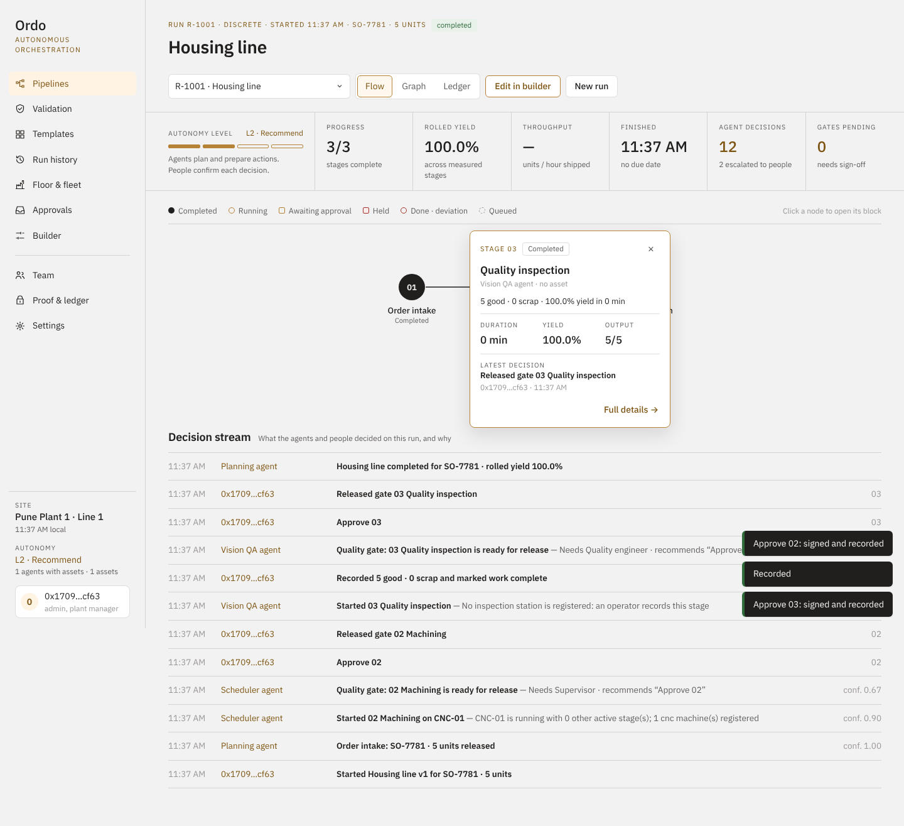
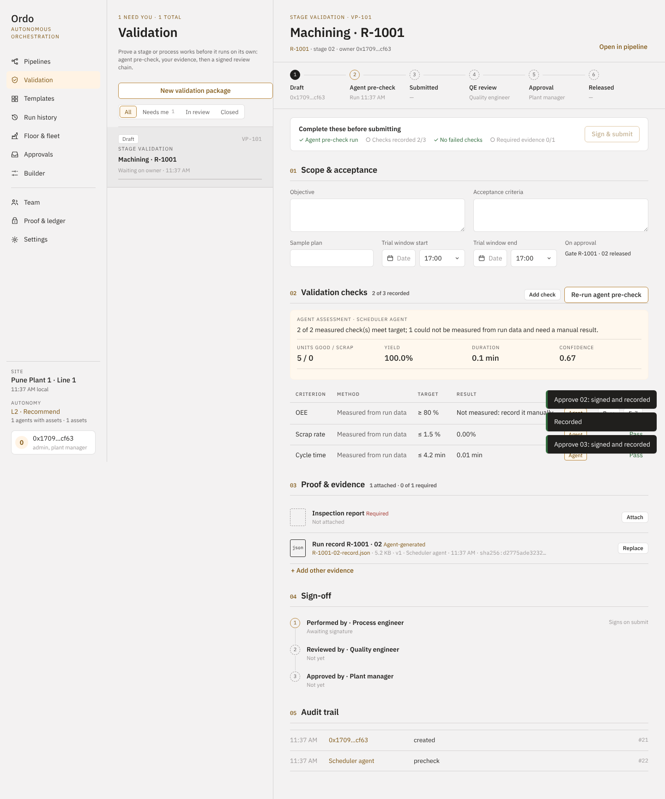
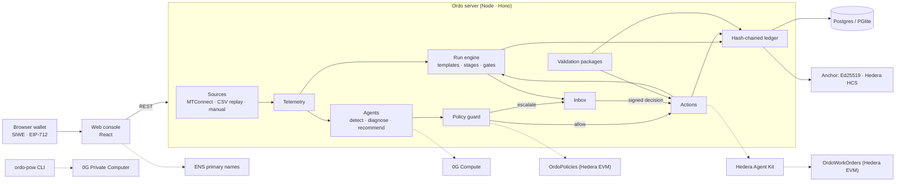

# Ordo — autonomous manufacturing orchestration, with proof

Ordo runs production pipelines across machines, robots, vehicles and people. Software agents execute each stage from live plant data, escalate what is out of policy, and record every decision with its reason and confidence. People stay in control through autonomy levels, approval gates and validation packages, and **every human decision is signed with the person's wallet**. The record is a hash-chained ledger anchored outside the database, so anyone can verify it was not changed.



## How it works

1. **Sign in with your wallet** (Sign-In with Ethereum). The first wallet creates an org and becomes its manager. Anyone can join an open org as a contributor; the manager makes people validators or testers and sets what each role sees (level 1–4 plus a line and stage scope).
2. **Connect real data.** Register each asset with a source: an MTConnect agent (Ordo reads `/probe` and `/current`), a CSV dataset recorded from a real machine and played back, or readings operators enter. Status, utilization and OEE are computed only from what is measured; without data the console shows "—".
3. **Pick a pipeline.** Fifteen library templates (discrete assembly, batch chemical, SMT, pharma GMP, predictive maintenance…) or your own from the **builder**, with parallel branches, merges, a rework loop, per-stage agent, resource, mode (Auto / Approve / Manual), success criteria, timeout and escalation role. Publishing creates an immutable version.
4. **Run it.** Stages are assigned to assets of the right kind. Progress comes from the machine's part counter or from what a manager records. Success criteria are evaluated on measured values; an unmeasured criterion is never assumed to pass, so a person confirms it at the gate.
5. **Agents watch the telemetry** against the limits you set. On a threshold, drift or controller fault they open an incident, diagnose it (Gemini, 0G Compute, or a grounded offline model), and recommend allow-listed actions: hold or reassign a stage, open a work order (which starts a predictive-maintenance run), raise inspection, or instruct an operator. The **policy guard** allows the action at the line's autonomy level or sends it to the inbox for the right role.
6. **The maintenance agent pays the vendor.** A work order goes to an onboarded vendor. With `OrdoWorkOrders` configured, the agent escrows the vendor's rate from the site's fund, from its own account, through **Hedera Agent Kit**: an Agent Kit policy lets it escrow only work orders Ordo opened, the contract enforces caps a manager signed and the vendor's on-chain credential, and a manager's signature releases the money. An unreleased escrow returns to the fund after 72 hours; a manager can stop the agent at once.
7. **People decide by signing.** Gate releases, inbox decisions, autonomy changes (a manager publishes each line's autonomy) and validation sign-offs are EIP-712 typed-data signatures with single-use nonces bound to the action and entity. The server verifies them before acting and stores them with the decision.
8. **Every lot carries a passport.** Each run gets a public page, opened by its QR code without signing in. The page shows what was made, stage by stage, who signed each gate and release (by wallet address), the validators' stake and the ledger anchor that proves it. With an HTS collection configured the passport is a **Hedera NFT**: it is minted when the lot starts, its metadata follows the lot when it is held or completed, and it is airdropped to the customer when a manager signs the shipment.
9. **Proof of work through 0G Private Computer.** A contributor opens a running stage, runs `npx ordo-pow@latest <token>`, and a TEE-hosted model interviews them through the 0G Router. Values are committed, the record is sealed, the contributor signs it, and a public proof shows commitments, evidence hashes and TEE receipts but no values. A staked validator selects the valid record, which closes the stage; a staked tester can open a case against that choice, which a manager decides. With OrdoTrust v3 (live on Hedera testnet), selections pay a reward and fee from a pool the manager funds, and upheld cases cut the validator's stake. See [docs/proof-of-work.md](docs/proof-of-work.md).
10. **Validation packages** prove a stage or change works: agent pre-check from run data, hashed evidence files, and a three-signature chain (performed, reviewed, approved) where one person cannot sign twice (an org's only manager may approve a package they performed; someone else still reviews it).
11. **Verify** re-walks the ledger from genesis and checks each anchor (Ed25519 checkpoint, or a Hedera Consensus Service message via the mirror node).



## Quick start

```bash
pnpm install
pnpm build
cd server && node dist/index.js        # http://localhost:8080
```

Open the console with a browser wallet (MetaMask, Rabby…), sign in, and create your org. Development with hot reload: `pnpm dev`, then http://localhost:5173. No database or API keys are needed locally: embedded Postgres (PGlite) and offline agents are the defaults. To try live machine data without hardware, add an asset with the MTConnect agent `https://demo.mtconnect.org`. All settings are in [`server/.env.example`](server/.env.example); check them with `pnpm env:doctor`. Proof of work runs locally without a Router key, on the agent's scripted interviewer; see [docs/proof-of-work.md](docs/proof-of-work.md#running-it-locally-without-a-router-key).

## Tests

| Command | What it covers |
| --- | --- |
| `pnpm --filter @ordo/server test` | API flows for the four roles, visibility, joining, proof-of-work sessions, selection and cases, plus the earlier suites: migrations, SIWE sessions and EIP-712 signatures, MTConnect parsing and SSRF guard, metrics from measured data, CSV replay, pipeline graph rules and criteria, the policy matrix, the ledger, signed gates and work orders, autonomy policies, validation chains with separation of duties, anchoring and verification; the on-chain layer against an in-process EVM (org registration, signed role grants, stakes, release records, the agent escrowing for a credentialed vendor, refunds, the pause, published policies); the Hedera Agent Kit tool; and lot passports |
| `pnpm --filter @ordo/contracts test` | On an in-process EVM: OrdoTrust v3 (grants, stakes, cases, rewards, settings), OrdoWorkOrders, OrdoPolicies, OrdoPayOnProof, stage and spec verifiers |
| `pnpm --filter ordo-pow test` | The terminal agent against a local Ordo API and Router |
| `pnpm e2e` | Playwright with an injected test wallet drives the real console: sign in, create a site, register an asset, record readings, build and publish a pipeline, run it, sign two gates, verify the ledger |
| `E2E_TARGET=vercel pnpm e2e` | The same flow against the Vercel build on real Postgres, with no background timer |

## Architecture



| Rail | Default | Partner |
| --- | --- | --- |
| Identity | Wallet sign-in (EIP-4361) | ENS primary names shown for team members |
| Decisions | EIP-712 signatures verified server-side | ERC-1271 smart wallets via `AUTH_RPC_URL` |
| Ledger anchor | Ed25519-signed checkpoint | Hedera Consensus Service topic, verified through the mirror node |
| Roles and stakes | Four roles kept in Ordo, granted by a manager's signature | `OrdoTrust`: credentials, validator and tester stakes, release records; v3 adds cases and rewards. v3 live on Hedera testnet at [`0x9294…32fc`](https://hashscan.io/testnet/contract/0x9294c81d116a9924edbaec601589ab00dca832fc) |
| Autonomy policies | A manager's signature, recorded in the ledger | `OrdoPolicies`: each change published on-chain with its signature |
| Lot passports | Public page and QR code for every lot, in Ordo | HTS NFT per lot (`HEDERA_PASSPORT_TOKEN_ID`): minted at start, metadata updated on hold and completion (HIP-657), airdropped to the customer on a signed shipment |
| Agent payments | Work orders assign a vendor, no money moves | `OrdoWorkOrders` via Hedera Agent Kit: per-site fund, manager-signed caps, credentialed vendors, escrow released by a manager's signature, refunds, kill switch |
| Deadlines | The server's engine cycle refunds expired escrows and raises stage timeouts | Hedera Schedule Service (HIP-423): the 72h escrow refund, the validator payout at the end of the unstake cooldown and each stage's timeout are scheduled transactions the network executes on time, even if Ordo is down |
| AI inference | Offline grounded model | Gemini, or 0G Compute (OpenAI-compatible) |
| Proof of work | Scripted interviewer, no TEE (no Router key) | 0G Private Computer Router (mainnet), private mode, per-session keys |

## Repository layout

```
server/      API, auth, plant data sources, run engine, agents, policy guard, validation, ledger
web/         console (React + Vite) with its own Select, calendar, modal and drawer components
contracts/   OrdoTrust, OrdoWorkOrders, OrdoPolicies, OrdoPayOnProof; Hedera / ENS / 0G setup scripts
sdk/        ordo-pow: the contributor's terminal agent (npm)
policies/    versioned autonomy policy
e2e/         Playwright flow with an injected test wallet
docs/        product, pipeline templates, validation workflow, environments, plans
mockups/     design mockups (PNG) · *.dc.html: original clickable prototype
```

## Deploy

**Render (primary).** `render.yaml` is a Blueprint: one Docker web service (the root `Dockerfile`: console, API, live stream, engine timer and the machine body bundle) with Render Postgres, the engine timer on, machine bodies on Vercel Sandbox (`BODY_RUNTIME=sandbox`), and every variable of `server/.env.example` as a secret entered in Render. Steps, secrets and a custom domain: [docs/environments.md](docs/environments.md#deploy-on-render); the sandbox runtime: [docs/machines.md](docs/machines.md#vercel-sandbox-runtime).

**Vercel.** `vercel.json` runs `pnpm vercel-build`, which writes the static console plus one Node function for `/v1/*`. All state is in Postgres (Neon from the Vercel Marketplace sets `DATABASE_URL`). Each console poll runs at most one engine cycle every 4 seconds across instances, under a database lease. Set `LEDGER_SIGNING_KEY`, and `BOOTSTRAP_ADMIN_ADDRESS` if only your wallet may create sites. The full workflow is in [docs/environments.md](docs/environments.md).

**Docker**: `docker build -t ordo . && docker run -p 8080:8080 ordo`. Use this on a plant network to reach MTConnect agents with private addresses, which the cloud deployment refuses.

## On-chain proof

Settled on Hedera testnet, each paid by an agent with no one approving:

| What | Who paid | Settled transaction |
|---|---|---|
| `assess_vibration` on Ordo's metered MCP server (x402, 0.1 HBAR) | buyer agent [0.0.11118723](https://hashscan.io/testnet/account/0.0.11118723) | [0.0.9185802@1792617008.223711953](https://hashscan.io/testnet/transaction/0.0.9185802-1792617008-223711953) |
| `forecast_failure` on Ordo's metered MCP server (x402, 0.1 HBAR) | buyer agent [0.0.11118723](https://hashscan.io/testnet/account/0.0.11118723) | [0.0.9185802@1792617008.694161567](https://hashscan.io/testnet/transaction/0.0.9185802-1792617008-694161567) |

Deployed on Hedera testnet for pay on proof:

| What | Where |
|---|---|
| Ordo USD (OUSD), created with Stablecoin Studio's SDK and factory | token [0.0.11123629](https://hashscan.io/testnet/token/0.0.11123629) · proxy [0.0.11123628](https://hashscan.io/testnet/contract/0xacb80acbc65d73f4b544e2324fa2f5dcc38c8594) |
| OrdoPayOnProof: pays a Stablecoin Studio hold only on a recorded quality release | [0x792d…d22f](https://hashscan.io/testnet/contract/0x792d5049fcaba10c04754a54f3025be19127d22f) |

Reproduce it with the **x402 demo** workflow (Actions tab): it opens a fresh buyer account and pays `https://aiwarriors.vercel.app/v1/x402/mcp` per tool call. Every sale is also listed at `GET /v1/x402`.

## What is real

- Everything in the console comes from what you connect or record. There is no simulator and no sample data in the console. For demos, the edge gateway can simulate a machine or an instrument profile (`SIM_PROFILE`), and a simulated expression run ships as a CSV fixture; see [docs/data-sources.md](docs/data-sources.md).
- A stage's criteria are measured parameters: counts and time, or an instrument's signals over the stage window, judged against bands and proven per bound in zero knowledge. Where the instrument has a gateway, the gateway signs the measurement commitment and the lot's on-chain release re-verifies the proof; values a person or the server recorded are proven on the passport only.
- Not included yet: OPC UA connectivity, ERP/MES integration, file storage outside Postgres (evidence is stored hashed in the database, up to 4 MB per file).
- Compliance features are designed to support 21 CFR Part 11-style records; Ordo is not a certified system.

## Prior work

The product idea, PRD, architecture docs and UI mockups existed before the application code. See [`docs/`](docs/README.md) and the original prototype `Ordo Orchestrator.dc.html`. No application code from the prototype is reused.
