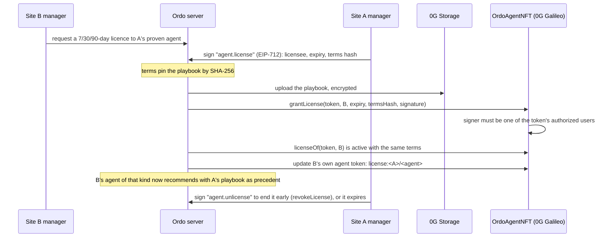

# Ordo contracts and chain setup

Three contracts on Hedera, and on Sepolia the ENS contracts that name everything under `ordo.eth` (below). Every authorisation in them is an Ordo EIP-712 signature (`OrdoSignature`, the typed data people sign in the console), so anyone can relay a transaction and the contract checks who signed, not who sent it.

| Contract | Purpose |
| --- | --- |
| `OrdoTrust` | Per-site role credentials (a manager holds ADMIN, PLANT_MANAGER, SUPERVISOR and VALIDATOR, 30), granted and revoked with an admin's signature; validator and tester stakes with an unstake cooldown (`withdrawFor` pays a stake back after it, the call Hedera's scheduler makes); release records that need a staked reviewer and a staked plant manager; v3 adds cases against validators and the reward pool ([below](#ordotrust-v3-four-roles-cases-and-rewards)). |
| `OrdoWorkOrders` | The maintenance agent pays vendors within limits people set: a per-site fund, per-order and per-day caps an admin signs, escrow only to holders of the site's `VENDOR` credential, release on a supervisor's or plant manager's signature, refund after expiry, and a pause an admin or plant manager signs (a manager holds all of these). |
| `OrdoPolicies` | Each line's autonomy level and policy hash, published with one plant manager's signature (`REQUIRED = 1`; more may sign, each a different plant manager). |
| `OrdoTreasury` | Each org's treasury is a Hedera account keyed to the org's own `OrdoTreasuryKey` contract. HBAR leaves it only through a scheduled transfer (a run budget or a machine's top-up) that one of the org's OrdoTrust admins approved: `approve` checks the `budget.approve` signature for exactly that schedule and has the key sign it through Hedera's Schedule Service (`authorizeSchedule`, HIP-755) ([below](#ordotreasury-run-budgets-the-manager-approves)). |
| `OrdoSpecVerifier` | Generated Groth16 verifier for `circuits/spec_check.circom`: checks a lot passport's proof that a criterion was met, without the measurement. Stateless; anyone can deploy and call `verifyProof`. |
| `OrdoStageVerifier` | Generated Groth16 verifier for `circuits/stage_check.circom`: checks that the counts a stage's gateway (or, for a manual stage, a manager) signed meet the stage's criteria. `OrdoRunResolver` calls it for every stage of a release. |
| `OrdoProofs` (library) | The two statements proof of work rests on: `OrdoReading` (a stage's counts as a signed commitment) and `OrdoRelease` (exactly what three people release: site, package, run, lot, content hash, proof root). See [docs/proof-of-work.md](../docs/proof-of-work.md). |

`OrdoWorkOrders` and `OrdoPolicies` read credentials from the deployed `OrdoTrust` and share its signature scheme through `OrdoSigned`.

```bash
pnpm --filter @ordo/contracts test     # compile with npm solc, and its tests on an in-process EVM
```

## OrdoTrust v3: four roles, cases and rewards

Ordo has four roles per org; OrdoTrust holds them as role bits:

| Bit | Value | |
| --- | --- | --- |
| `OPERATOR` | 1 | |
| `SUPERVISOR` | 2 | |
| `VALIDATOR` | 4 | Stakes; its signature records an acceptance and reviews a release |
| `PLANT_MANAGER` | 8 | Approves releases, decides cases, publishes autonomy policies |
| `ADMIN` | 16 | Grants and revokes roles, signs settings and caps |
| `VENDOR` | 32 | Receives work-order escrow |
| `DEVICE` | 64 | A machine's gateway: signs stage readings |
| `TESTER` | 128 | Stakes and opens cases against validators |
| `MANAGER` | 30 | `ADMIN`, `PLANT_MANAGER`, `SUPERVISOR` and `VALIDATOR`: every right at an org |

| Ordo role | OrdoTrust credential |
| --- | --- |
| Manager | `MANAGER`. The admin who registers the org becomes one. |
| Validator | `VALIDATOR` |
| Tester | `TESTER` |
| Contributor | None: paid from the reward pool, proven by their own signatures |

`grantRole` and `revokeRole` need an `ADMIN`'s signature, and `revokeRole` keeps one admin per org (`LastAdmin`).

**Stakes.** A `VALIDATOR` or a `TESTER` stakes. A stake is active while its owner holds the role, has not requested to unstake and has at least `minStake`. After `requestUnstake` the stake is inactive at once and can be withdrawn after the cooldown, but not while its owner is the tester or validator of an undecided case (`CaseOpen`).

**Rewards.** Anyone adds to an org's pool (`fundRewards`). `recordAcceptance` takes a validator's `contribution.select` signature (entity `<contributionId>#<0xcontributor>`) from an active staked validator who is not the contributor, reserves `reward + fee` from the pool (`PoolTooLow` if it holds less) and vests them after the challenge window. After that, anyone settles an unfrozen acceptance (`settle`): the reward is credited to the contributor and the fee to the validator. `claim` pays the caller's claimable balance; `claimFor` pays an account's balance to that account, so Ordo's relayer can pay the gas.

**Cases.** An active staked tester, not the validator, opens a case against a holder of `VALIDATOR` (`openCase`, action `case.open`, entity `<0xvalidator>#<bps>#<caseId>#<0xevidenceHash>`), proposing up to `maxSlashBps` of their stake. Naming an acceptance freezes it, and only while it is unsettled and inside its challenge window (`ChallengeClosed`, `UnknownAcceptance` otherwise). The validator answers before the response window ends (`respond`, entity `<caseId>#<0xresponseHash>`). A plant manager who is neither party decides once the validator answered or the window closed (`decideCase`, entity `<caseId>#uphold` or `<caseId>#reject`):

- upheld: `bps` of the validator's stake is cut; `bountyBps` of the cut is credited to the tester and the rest is paid to the org's quality fund (its treasury); a frozen acceptance loses its fee, which returns to the pool;
- rejected: `falseClaimBps` of the tester's stake is credited to the validator.

**Settings.** Each org's settings are changed with an `ADMIN`'s signature (`setSettings`, action `site.settings`, entity `r<reward>#f<fee>#c<challengeWindow>#w<responseWindow>#d<defaultSlashBps>#m<maxSlashBps>#b<bountyBps>#x<falseClaimBps>`). Basis points are at most 10000, and `defaultSlashBps` at most `maxSlashBps`. They apply to acceptances and cases made afterwards. `registerSite` starts an org with:

| Setting | Default |
| --- | --- |
| `reward` | 100000000 (1 HBAR) |
| `fee` | 20000000 (0.2 HBAR) |
| `challengeWindow` | 3 days |
| `responseWindow` | 48 hours |
| `defaultSlashBps` | 3000 |
| `maxSlashBps` | 5000 |
| `bountyBps` | 5000 |
| `falseClaimBps` | 1000 |

Amounts are in the chain's smallest unit: tinybars on Hedera.

**Removed from v2:** `slash` (two validators plus a plant manager), now cases; and OrdoPolicies' two-signature raise (`REQUIRED = 1`).

**How Ordo tells.** The server checks the configured contract for `isActiveTester(string,address)`. Against v2 it keeps selections in its ledger, refuses cases and turns rewards off; the env doctor warns "chain: OrdoTrust v3". The whole flow is in [docs/proof-of-work.md](../docs/proof-of-work.md).

**Unchanged:** `OrdoAgentNFT`. ENS roles come from the names people hold under `ordo.eth` (`OrdoNames`, below).

## Hedera testnet

### Live on Hedera testnet (v3)

Deployed 5 Nov 2026, chain 296:

| What | Where |
| --- | --- |
| `OrdoTrust` | [`0x9294c81d116a9924edbaec601589ab00dca832fc`](https://hashscan.io/testnet/contract/0x9294c81d116a9924edbaec601589ab00dca832fc) |
| `OrdoWorkOrders` | [`0xffb1d1d8111ec261484db49c9670ccc148ac8e5e`](https://hashscan.io/testnet/contract/0xffb1d1d8111ec261484db49c9670ccc148ac8e5e) |
| `OrdoPolicies` | [`0x6b8a5fac0bfc58010442ec16310cbaec49bd562e`](https://hashscan.io/testnet/contract/0x6b8a5fac0bfc58010442ec16310cbaec49bd562e) |
| `OrdoPayOnProof` | [`0x792d5049fcaba10c04754a54f3025be19127d22f`](https://hashscan.io/testnet/contract/0x792d5049fcaba10c04754a54f3025be19127d22f) |
| Registrar and relayer | [`0xCe44d739E6FC129FE0B85f472d84B76df9170EA0`](https://hashscan.io/testnet/account/0xCe44d739E6FC129FE0B85f472d84B76df9170EA0) |
| Ledger topic (HCS) | [`0.0.11087048`](https://hashscan.io/testnet/topic/0.0.11087048) |
| Lot passport collection (HTS NFT) | [`0.0.11087232`](https://hashscan.io/testnet/token/0.0.11087232) |
| Maintenance agent account | [`0.0.11324776`](https://hashscan.io/testnet/account/0.0.11324776) |

The previous OrdoTrust, v2 at `0xaed8e264873505bf81a9faba7e1542b07b4e8895`, still holds the stakes made on it: their owners request to unstake there and withdraw after the cooldown.

Deployments run in GitHub Actions with the operator account held in the `hedera-testnet` environment (`HEDERA_OPERATOR_ID`, `HEDERA_OPERATOR_KEY`, an **ECDSA** key):

- **Deploy OrdoTrust** (`.github/workflows/deploy-trust.yml`): push a change to `.github/deploy/trust.request`.
- **Hedera setup** (`.github/workflows/hedera-setup.yml`): list what to create in `.github/deploy/hedera.request` and push it:
  - `topic` creates the HCS topic the ledger is anchored to (`HEDERA_TOPIC_ID`),
  - `contracts` deploys `OrdoWorkOrders` and `OrdoPolicies` against `OrdoTrust` (`TRUST_WORKORDERS_ADDRESS`, `TRUST_POLICIES_ADDRESS`),
  - `passport` creates the HTS NFT collection for lot passports (`HEDERA_PASSPORT_TOKEN_ID`); the operator is treasury, supply and metadata key,
  - `agent` creates the maintenance agent's own account with 20 HBAR (`HEDERA_AGENT_ID`); its key goes straight to Vercel and is never printed, so this one needs `VERCEL_TOKEN` as a repository secret.

The logs print only public values. The same scripts run locally:

```bash
cd contracts
export HEDERA_OPERATOR_ID=0.0.xxxx HEDERA_OPERATOR_KEY=0x<ecdsa hex>
pnpm deploy:trust
pnpm setup:hedera topic
TRUST_CONTRACT_ADDRESS=0x… pnpm setup:hedera contracts
SECRET_OUT=agent.env pnpm setup:hedera agent
cd ../server && pnpm smoke:hedera      # posts an anchor to the topic and verifies it on the mirror node
```

Then, in Ordo: register the org on-chain (Setup asks right after creating it; Settings retries), sign the agent's caps and add funds (Work orders), and add vendors (Team → Vendors). When the agent's work order is approved, or it acts on its own at L4, it escrows through Hedera Agent Kit; a manager's signature pays the vendor.

Things to check on the day:

- Inside the EVM Hedera counts HBAR in tinybars (8 decimals); JSON-RPC `value` uses 18 decimals. Caps and amounts in the contracts are tinybars.
- The agent account is created with an ECDSA alias, so its EVM address (the one the caps are signed for) is derived from its key.
- Verify contract source on Sourcify for chain 296 so HashScan shows it; `artifacts/*.json` has the ABI and bytecode.

### Redeploying

A new OrdoTrust starts empty and its signatures are bound to its address, so a redeploy starts every org over on-chain and spends testnet HBAR from the operator. Run the scripts locally (the GitHub workflows at the repository root still assume the workspace sits at the root):

```bash
cd contracts
export HEDERA_OPERATOR_ID=0.0.xxxx HEDERA_OPERATOR_KEY=0x<ecdsa hex>
pnpm deploy:trust                                            # OrdoTrust; prints the TRUST_* values
TRUST_CONTRACT_ADDRESS=0x<new> pnpm setup:hedera contracts   # OrdoWorkOrders + OrdoPolicies against it
TRUST_CONTRACT_ADDRESS=0x<new> STABLECOIN_ADDRESS=… STABLECOIN_TOKEN_ADDRESS=… pnpm setup:hedera payonproof
```

`deploy:trust` reads `MIN_STAKE` (whole native units, default 10), `UNSTAKE_COOLDOWN_SECONDS` (default 7 days) and `TRUST_REGISTRAR` (default the deployer; set it to the relayer's address). Then:

1. Update `TRUST_CONTRACT_ADDRESS`, `TRUST_WORKORDERS_ADDRESS`, `TRUST_POLICIES_ADDRESS` and `PAY_ON_PROOF_ADDRESS` in Vercel and `server/.env`.
2. Run `pnpm run doctor` in `server/`: the "chain: OrdoTrust v3" warning goes once the contract is v3.
3. Every org registers again (Setup asks right after an org is created; Settings retries), managers re-record credentials (Team → Stakes), and validators and testers stake on the new contract.
4. Stakes on the old contract stay there: their owners request to unstake on it and withdraw after the cooldown.

The HCS topic, the passport collection, the agent account and the ENS contracts are unaffected.

## Deadlines on Hedera's Schedule Service

Three deadlines run as Hedera scheduled transactions (`ScheduleCreateTransaction` with `waitForExpiry`, HIP-423) that the network executes at their expiration time, so they happen even if Ordo is down. The operator pays and holds the admin key, and Ordo deletes a schedule that is no longer needed (`server/src/core/schedules.ts`, `server/src/chain/hedera.ts`):

| Deadline | Scheduled transaction | Deleted when |
| --- | --- | --- |
| Work-order escrow, 72h after it opens | `OrdoWorkOrders.refund(site, workOrder)` at the on-chain `expiresAt` | a manager releases the payment |
| Validator or tester unstake cooldown | `OrdoTrust.withdrawFor(site, validator)` at `unlockAt`, paying the stake back to the validator | the validator stakes again |
| Stage timeout | an HCS message `{kind:"stage.timeout"}` to the ledger topic at the deadline; Ordo raises the inbox item once the mirror node shows it executed | the stage finishes in time |

Ordo only does the job itself when a schedule could not be created (less than a minute or more than 62 days away, or Hedera unreachable) or has not run 5 minutes after its time. `HEDERA_SCHEDULES=off` turns it off.

The deployed OrdoTrust (v3) has `withdrawFor`, so Ordo schedules each stake's payout for the end of its cooldown. Against an older OrdoTrust without it, Ordo sees the function is missing and validators and testers withdraw from their wallets instead.

## OrdoTreasury: run budgets the manager approves

An org's machines buy what their stages consume over x402 from their own Hedera accounts. The money comes from the org's treasury, and only with a manager's approval that the ledger itself enforces (`server/src/core/budgets.ts`, `server/src/chain/treasury.ts`; the pitch is in [docs/hedera.md](../docs/hedera.md)):

1. **The treasury account's key is a contract.** `OrdoTreasury.openSite(site)` creates the org's `OrdoTreasuryKey` (CREATE2, once per registered site), and Ordo creates a Hedera account whose key is that contract's id. No server key can sign for it (the operator's own transfer from it fails with `INVALID_SIGNATURE`); anyone can fund it.
2. **A run's budget is one scheduled transfer.** When a run starts, Ordo creates one `ScheduleCreate` wrapping a multi-recipient HBAR transfer from the treasury to the run's machine accounts (Σ qty × maxPrice of each stage's resources, plus a margin), memo `ordo:budget:<run>`, expiring in 24 h (HIP-423).
3. **The manager approves it.** The console reads the schedule's body from the mirror node, checks the recipients and amounts are the ones Ordo shows, and the manager signs `budget.approve` for `<scheduleId>#<sha256 of the treasury and credits>` (domain version 2, `verifyingContract` = OrdoTreasury). Ordo's relayer sends `approve(site, schedule, entity, sig)`; the contract checks the signer is an OrdoTrust ADMIN of the org, burns the nonce, and the org's key calls `authorizeSchedule(schedule)` at `0x16b`. The schedule executes at that consensus instant, or lapses at its expiry.
4. **Over budget.** A machine whose purchase exceeds its balance posts its reasoning (with its 0G request id) to `POST /v1/edge/overbudget`. Ordo writes the reasoning to HCS first, then schedules a top-up of the shortfall and raises a manager inbox item; approval works as above. If the top-up expires or is declined, the stage that needed the resource is held as "not approved".

Each org's account answers only to its own key contract, so a manager of one org cannot approve another org's spending, and a compromised server cannot pay anyone without the owning org's manager.

```bash
cd contracts
export HEDERA_OPERATOR_ID=0.0.xxxx HEDERA_OPERATOR_KEY=0x<ecdsa hex>
TRUST_CONTRACT_ADDRESS=0x<OrdoTrust> pnpm setup:hedera treasury                    # deploys OrdoTreasury: TREASURY_CONTRACT_ADDRESS
TREASURY_CONTRACT_ADDRESS=0x<OrdoTreasury> pnpm setup:hedera treasury site_… 50    # an org's treasury account with 50 HBAR
```

The second command needs the org registered in OrdoTrust; link the account it prints in Finance → Machine budgets (a manager can also open one there, which the operator seeds with `TREASURY_SEED_TINYBARS`).

**Live (6 Nov 2026):** `OrdoTreasury` [`0xe90e…c1bb`](https://hashscan.io/testnet/contract/0xe90ec7e22864dca8cdcafc1e94d7f9e0b94dc1bb) against OrdoTrust v3. The spike that proved the design on testnet is recorded in [docs/hedera.md](../docs/hedera.md#what-the-testnet-spike-showed).

## Zero-knowledge spec proofs

A lot's public passport says whether each acceptance criterion was met but never shows the measurement (yields, scrap, cycle times and OEE are trade secrets). When a stage closes, the server commits each measured value as `Poseidon(subject, value, salt)` in the hash-chained ledger (so it is anchored with everything else), and for every criterion that passed it proves with Groth16 that the committed value meets the target. The passport carries the proof and its public signals `[subject, target × 10⁴, op, commitment]`; the server, the buyer's browser (snarkjs) or `OrdoSpecVerifier` can each check it, with the key at `GET /v1/public/zk/spec-check`.

The circuit's keys live in `server/zk`. Rebuild them after changing the circuit (needs the [circom 2](https://docs.circom.io/getting-started/installation/) compiler; the trusted setup is a local single-party ceremony, fine for a demo, not for production):

```bash
cd contracts && CIRCOM=/path/to/circom node scripts/zk-spec-setup.mjs setup "Your name"
```

## Zero-knowledge stage proofs (proof of work)

Each stage's counts are signed where they were made and proven against the stage's criteria; a release signs the root of those proofs and `OrdoRunResolver` verifies them on-chain. The design and trust model are in [docs/proof-of-work.md](../docs/proof-of-work.md). The circuit is on a public trusted setup (phase 1 from the PSE Perpetual Powers of Tau; phase 2 contributions are recorded in `server/zk/stage_check.ceremony.json`):

```bash
cd contracts && CIRCOM=/path/to/circom node scripts/zk-stage-setup.mjs setup      # compile + phase 2 + first contribution
node scripts/zk-stage-setup.mjs contribute "Your name"                              # each further contributor
node scripts/zk-stage-setup.mjs beacon <future block hash>                          # close the ceremony
node scripts/zk-stage-setup.mjs verify                                              # anyone: check the zkey
```

## Build log on HCS

Post the current commit to the HCS build topic every few hours:

```bash
cd server && HEDERA_BUILD_TOPIC_ID=<build topic> pnpm anchor:build
```

## ENS (Sepolia, ENSv2)

Everything in Ordo has an ENSv2 name under one root, and each name that holds others has its own registry:

```
ordo.eth                                              root (Ordo's PermissionedResolver)
└─ acme.ordo.eth                                      org (own registry)
   ├─ priya.acme.ordo.eth                             a person's handle, owned by their wallet, cannot be transferred
   ├─ managers | validators | testers | contributors  role collections (own registries)
   │    └─ priya.validators.acme.ordo.eth             holding it is holding the role
   ├─ machines → robot-cell-1.machines.acme.ordo.eth  owned by the device signer
   ├─ agents · lines · vendors · customers · financiers · pipelines · workorders · treasury
   └─ runs → so-7781.runs.acme.ordo.eth               a run (own registry; resolver OrdoRunResolver)
        ├─ 01-wax-pattern-injection.so-7781.runs.acme.ordo.eth   its stages
        ├─ budget.so-7781.runs.acme.ordo.eth                     its budget
        └─ topup-01-ceramic-cores.so-7781.runs.acme.ordo.eth     an over-budget top-up
```

Names carry small `com.ordo.*` text records that point at other names (a stage's `com.ordo.machine`, a role name's `com.ordo.person`), and the Hedera ones an ENSIP-11 address for Hedera testnet (coin type `2147483944`, `0x80000000 | 296`). Display names never go on-chain.

### Setup

1. `scripts/ens-setup.ts` registers the root once. It deploys Ordo's `PermissionedResolver` and a `UserRegistry` through ENS's `VerifiableFactory`, registers `<label>.eth` for `ENS_YEARS` (default 2, so the root outlives the one-year names under it) through the ETHRegistrar (commit, wait, pay in the testnet's MockUSDC), and records the registry's parent.

   ```bash
   ENS_OWNER_KEY=0x... ENS_LABEL=ordo pnpm setup:ens
   ```

2. `scripts/ens-contracts.ts` deploys `OrdoNames` and `OrdoRunResolver`, and grants `OrdoNames` registrar, unregister, renew, set-registry and set-resolver on the root's registry, and set address, text and contenthash on the resolver. The verifiers are reused from `ENS_STAGE_VERIFIER_ADDRESS`/`ENS_SPEC_VERIFIER_ADDRESS` or the retired lot resolver (`ENS_LOT_RESOLVER_ADDRESS`), else deployed.

   ```bash
   ENS_OWNER_KEY=0x... ENS_PARENT_NAME=ordo.eth ENS_REGISTRY_ADDRESS=0x... ENS_RESOLVER_ADDRESS=0x... pnpm setup:ens-contracts
   ```

Both default to Tenderly's public gateway, then thirdweb, 0xrpc and 1rpc (`ENS_SEPOLIA_RPC_URL` takes a comma list; 1rpc rate-limits bursts and drpc's free plan no longer serves Sepolia), print only public values, and end with the env vars to set. The ENS contract addresses are the Sepolia set ENS Labs deployed on 2026-10-01 (`server/src/chain/ensv2.ts`).

### Live on Sepolia (6 Nov 2026)

| | Address |
| --- | --- |
| Root | [`ordo.eth`](https://sepolia.app.ens.domains/ordo.eth), registered for 2 years, owner `0x38e6…5b74` |
| Root registry (UserRegistry) | [`0xA15E…7CbE`](https://sepolia.etherscan.io/address/0xA15E53dCCAb3D4b8f63aC30c21206FC5E2d67CbE) |
| Ordo's resolver (PermissionedResolver) | [`0x2bF3…f238`](https://sepolia.etherscan.io/address/0x2bF3FEdAa5911CCF6F49468620150Ec6876Ff238) |
| `OrdoNames` | [`0x15f8…bb6b`](https://sepolia.etherscan.io/address/0x15f8e8cccf442e98369415fa9413b3b19d4bbb6b), holding its roles on the root registry and the resolver |
| `OrdoRunResolver` v2 | [`0xede9…ff51`](https://sepolia.etherscan.io/address/0xede955d6d5880a57219a10918be211b75914ff51), with the verifiers below: runs named from 6 Nov 2026 |
| `OrdoRunResolver` v1 | [`0x0fd6…223f`](https://sepolia.etherscan.io/address/0x0fd6d4a5edf16d6df8d4ab3e541e417a7776223f): runs named before v2 keep it, with their releases |

### Contracts

| Contract | Purpose |
| --- | --- |
| `OrdoNames` | Issues every name under the root. `execute(Op[])` takes a batch of ops (issue, records, revoke, grant, ungrant), each run on its own, so one bad name emits `Failed(index, reason)` and the rest land (`Applied`). Issuing is an upsert: it deploys the name's own registry at its predicted address (`predictRegistry(salt)`) if the name has one, registers the label or fixes its registry and resolver, records the registry's parent, and writes the records in one resolver multicall, so a child can ride in the same batch as its parent. It keeps each org's registries (org, managers, validators, testers, contributors, machines, vendors, runs) and which label is whose. Roles are the names people hold, read from those registries: a handle in the org and a name in `managers` is 31 (operator, supervisor, validator, plant manager, admin), `validators` 4, `testers` 128, `contributors` 1; a machine name gives DEVICE (64) to its signer, a vendor name VENDOR (32). It answers OrdoTrust's `sites`/`roles`/`hasRole` (`IOrdoTrust`), and `nameOf(site, account)` gives an account's full name. |
| `OrdoRunResolver` | The resolver of every run name. `runNode(site, name)` accepts only `<label>.runs.<org>.<root>` with the label registered in the org's runs registry. `recordRelease` stores a lot's release only with the three `OrdoRelease` statements (the lot is the run's full name) from people whose names give the roles (any role, VALIDATOR, VALIDATOR and PLANT_MANAGER, which a manager holds), and only if every stage proof verifies (`OrdoStageVerifier`) and every parameter proof verifies (`OrdoSpecVerifier`), and together they fold to the proof root the three signed. Each is signed by the machine that ran the stage, as the run name's `com.ordo.machine.<stage>` record says, while it holds DEVICE and its name in the org's attesters registry (slot `ATTESTERS = 9`), or by an OPERATOR for a stage run by hand (record empty or `manual`); anything else reverts `WrongMachine(stage, signer)`. This is v2; v1 (`0x0fd6…223f`) took any DEVICE or OPERATOR of the org for any stage, and runs named under it keep it. It answers the `com.ordo.release*` records from storage, signers as names, and every other record from Ordo's resolver, with multicall for the ENS app. No gateway. |
| `OrdoStageVerifier` | The Groth16 verifier of the stage-check circuit (counts against yield, scrap, defects and cycle-time criteria), generated by `zk-stage-setup.mjs` from the public ceremony. |
| `OrdoSpecVerifier` | The Groth16 verifier of the spec-check circuit (one measured value against one bound), generated by `zk-spec-setup.mjs` from the public ceremony. |

`OrdoEns.sol` holds the shared ENSv2 interfaces and the `OrdoEnsName` library (DNS encoding, namehash, split, join). `compile.mjs` fails if `OrdoNames` or `OrdoRunResolver` is over 24,576 bytes deployed.

**Retired:** `OrdoEnsRoles` (roles from a `com.ordo.roles` text on `member-<address>` names) and `OrdoLotResolver` (wildcard `lot-<order>` names answered by a CCIP-Read gateway), live since 24 Oct 2026 under `ordo-mfg.eth`. Their names stay on-chain, untouched; the verifiers (`OrdoStageVerifier` [`0xadf0…3d22`](https://sepolia.etherscan.io/address/0xadf064b185151dad607a86f48166c36df1333d22), `OrdoSpecVerifier` [`0xd4c4…ed17`](https://sepolia.etherscan.io/address/0xd4c4b8438c6519d6830668365068560e0239ed17)) carry over.

## 0G (Galileo testnet, chain 16602)

`src/OrdoAgentNFT.sol` makes each agent of each site an ERC-7857 iNFT: its intelligent data is the policy hash it acts under, its model, the autonomy each line gives it and its scope; Ordo updates it when any of those change (`Updated` events), and the org's managers are its authorized users. Agents belong to their site, so tokens do not transfer. It uses OpenZeppelin's ERC-721, which needs Cancun, so `compile.mjs` compiles it in a separate Cancun pass (0G supports Cancun) and its tests run on anvil.

**Live:** `OrdoAgentNFT` `0x9577498d6305a8498744ab33217fab6722ff8141` on 0G Galileo, minter `0xa902C5542Fc209e639Ed151a3619e103D18bD55a`.

### Licensing a proven agent to another site

Agents don't transfer, but a site can license one. An agent is **proven** once people have decided at least 3 of its recommendations and accepted at least 75% (`PROVEN` in `server/src/core/agent-licenses.ts`). Its **playbook** is the accepted cases: asset kind, signal, the actions taken and their settings, not the site's ids.



`grantLicense` and `revokeLicense` take the same `OrdoSignature` typed data as the Hedera contracts, with the domain on chain 16602, so the wallet signs for 0G Galileo. The contract rebuilds the entity (`<site>/<agent>><licensee>#<expiresAt>#<termsHash>`) and rejects a signer who isn't an authorized user of that token, whoever relays it. Only sites that list publicly (Settings → public pipelines) appear to other sites as licensors.

**After this merges, redeploy the contract:** the licence functions are new, so the live `0x9577…8141` doesn't have them. Put `inft` in `.github/deploy/zerog.request` on `main` and push; the workflow deploys the new `OrdoAgentNFT` and writes `ZG_INFT_ADDRESS` to Vercel. Don't push that file on a branch, because the workflow runs on any push that changes it. Ordo notices the new address and mints every agent again on the new contract.

The **0G setup** workflow (`.github/deploy/zerog.request`; `key` generates Ordo's 0G key and keeps it in Vercel) deploys it (`inft`), turns on evidence copies to 0G Storage (`storage`) and funds the 0G Compute ledger (`ledger`), and writes the values and the key to Vercel. Locally:

```bash
ZG_PRIVATE_KEY=0x... pnpm setup:zerog                          # deploy OrdoAgentNFT → ZG_INFT_ADDRESS
ZG_PRIVATE_KEY=0x... pnpm --filter @ordo/server zerog:ledger   # fund 0G Compute (3 0G), list providers
```
