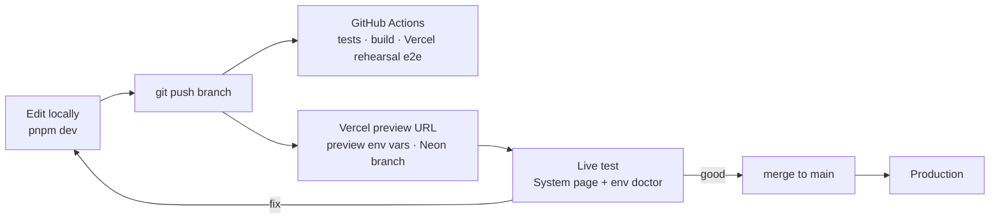

# Environments, configuration and live testing

One place holds every setting for every environment: **Vercel project environment variables**. Local work pulls from it, preview deployments read it per branch, production reads it on promote. Nothing secret lives in the repo. Branches under `claude/` get no preview deployment (`git.deploymentEnabled` in `vercel.json`): the Hobby plan limits how many branches can deploy, and CI already builds and tests the Vercel output on every PR.

## The three environments

| Environment | URL | Database | Rails | Used for |
| --- | --- | --- | --- | --- |
| **Development** | `localhost:5173` (or `:8080`) | Embedded PGlite, or a Neon dev branch | Whatever is in your pulled `.env` | Building and debugging |
| **Preview** | one URL per branch / pull request, e.g. `ordo-git-feat-x.vercel.app` | Neon branch per preview (automatic with the Neon integration) | Testnets (Hedera, Sepolia, 0G Galileo), the 0G Private Computer Router on mainnet, Gemini | **Live testing and rework**: every push gets a fresh live URL |
| **Production** | `ordo.vercel.app` (or your domain) | Neon `main` | Testnets for the hackathon, the 0G Private Computer Router on mainnet | The judge demo |

## Networks

| Rail | Network | Variables |
| --- | --- | --- |
| OrdoTrust, OrdoWorkOrders, OrdoPolicies, OrdoPayOnProof, HCS anchors, lot passports, schedules | Hedera testnet (chain 296) | `TRUST_*`, `HEDERA_*`, `PAY_ON_PROOF_ADDRESS` |
| ENS names, OrdoEnsRoles, OrdoLotResolver | Sepolia | `ENS_*` |
| 0G Storage, 0G Compute, OrdoAgentNFT | 0G Galileo testnet (chain 16602) | `ZG_RPC_URL`, `ZG_INDEXER_URL`, `ZG_PRIVATE_KEY`, `ZG_INFT_ADDRESS` |
| 0G Private Computer Router (proof-of-work interviews) | 0G mainnet by default, where the account's credits are; `ZG_ROUTER_NETWORK=testnet` switches it | `ZG_ROUTER_*` |

Each rail switches on by its own variables. Ordo's own 0G wallet needs no mainnet funds: the Router bills the pc.0g.ai account behind the management key.

## How a change flows (the rework loop)



1. Work locally with `pnpm dev`. Pull settings with `npx vercel env pull server/.env --environment=development`.
2. Push a branch. Vercel builds a **preview** deployment with the **Preview** variables, and the Neon integration gives it its own database branch, so test data never touches production.
3. Open the preview URL and sign in with your wallet. **Settings** shows which rails are live (database, identity, signatures, AI, anchor, payments, policy registry, 0G Private Computer) and the commit it runs.
4. Fix and push again; the preview URL updates. Merge to `main` to ship to production. Roll back with **Instant Rollback** in the Vercel dashboard if needed.

## One-time setup

```bash
npm i -g vercel                     # or use npx vercel
vercel login
vercel link                         # in the repo root; creates .vercel/project.json (git-ignored)
```

In the Vercel dashboard:

1. **Import the GitHub repo** (`AloysJehwin/ordo`). Root directory: repo root. The included `vercel.json` sets the install and build commands; leave the framework as "Other".
2. **Storage → Marketplace → Neon → Add.** Connect it to the project for Production, Preview and Development. It sets `DATABASE_URL` for you and creates a database branch per preview deployment.
3. **Settings → Environment Variables:** add the variables below, or push them from a file with the script (next section).
4. **Settings → Deployment Protection:** keep Vercel Authentication on for previews if only you test them; turn it off for production so judges can open it. Access inside the app is by wallet sign-in and per-org roles (manager, validator, tester, contributor). Set `BOOTSTRAP_ADMIN_ADDRESS` to your wallet if only you may create sites.

## Keeping variables in sync

Keep local, git-ignored files per environment (`.env.preview`, `.env.production`) as your working copies, and push them:

```bash
export VERCEL_TOKEN=...             # vercel.com/account/tokens — never commit it
pnpm env:vercel status              # table: which variable is set in production / preview / development
pnpm env:vercel push .env.preview preview
pnpm env:vercel push .env.production production
npx vercel env pull server/.env --environment=development
```

The push uses Vercel's API with upsert, marks keys, secrets, passcodes and database URLs as **sensitive** (write-only in the dashboard), and never prints values. Variables take effect on the next deployment.

### Secrets that live in GitHub

Chain keys are kept as GitHub environment secrets (`hedera-testnet`, later `sepolia` and `zerog-testnet`) and copied to Vercel by the **Sync secrets to Vercel** workflow, so they never pass through a laptop. `.github/vercel-secrets.map` lists them by name:

```
# <GitHub environment>  <GitHub secret>       <Vercel variable>     [format]  [Vercel targets]
hedera-testnet          HEDERA_OPERATOR_KEY   TRUST_RELAYER_KEY     evm-key
```

To add one: create the secret in its GitHub environment, add a line, push. Editing the map runs the workflow (one job per environment listed); it needs `VERCEL_TOKEN` as a repository secret. `evm-key` turns a Hedera portal key (hex or DER) into `0x` + 64 hex. Locally, `pnpm secrets:sync <environment>` does the same from your shell's variables.

## Check before you test: env doctor

```bash
pnpm env:doctor                                                   # local .env
npx vercel env pull .env.preview --environment=preview && \
  (cd server && node --env-file=../.env.preview --import tsx scripts/doctor.ts)
```

It validates every variable and checks each configured rail against the real service: database and schema, Gemini model, Hedera operator balance, ledger topic, JSON-RPC chain id, vault deployment and balance, policy registry match, ENS reverse resolution, 0G endpoints, the 0G Private Computer (management key, Router balance, a healthy private-mode TeeML provider for the chat model, the audio model served as TeeML), and whether OrdoTrust is v3. It exits non-zero on any failure, so it can gate a deploy. `pnpm run doctor` in `server/` is the same as `pnpm env:doctor` at the root.

## Variables

| Variable | Dev | Preview | Prod | Notes |
| --- | --- | --- | --- | --- |
| `DATABASE_URL` | optional | Neon (auto) | Neon (auto) | Required on Vercel |
| `LEDGER_SIGNING_KEY` | optional | **set** | **set** | Same value everywhere you want anchors to verify. Generate: see `server/.env.example` |
| `BOOTSTRAP_ADMIN_ADDRESS` | optional | optional | **set** | Only this wallet may create sites. Unset: any signed-in wallet creates its own site |
| `SESSION_TTL_HOURS` | 72 | 72 | 72 | Wallet session length |
| `AUTH_RPC_URL` | – | optional | optional | Lets smart-contract wallets (ERC-1271) sign in and sign decisions |
| `SIGNATURE_CHAIN_ID` | 296 | 296 | 296 | Chain id in EIP-712 signatures when the wallet does not report one |
| `ANCHOR_EVERY` | 50 | 50 | 50 | Anchor the ledger head after this many new entries (and every 30 min) |
| `TRUST_RPC_URL`, `TRUST_CHAIN_ID`, `TRUST_CONTRACT_ADDRESS`, `TRUST_RELAYER_KEY` (+ `TRUST_CHAIN_NAME`, `TRUST_EXPLORER_URL`, `TRUST_SYMBOL`, `TRUST_DECIMALS`) | – | Hedera testnet | Hedera testnet | OrdoTrust: role credentials, validator and tester stakes, release records; with v3 also cases and rewards. From the **Deploy OrdoTrust** workflow, or `pnpm deploy:trust` ([contracts/README.md](../contracts/README.md#redeploying)). Without them roles live in Ordo only and nobody stakes |
| `TRUST_WORKORDERS_ADDRESS`, `TRUST_POLICIES_ADDRESS` | – | Hedera testnet | Hedera testnet | OrdoWorkOrders (agent escrow for vendors) and OrdoPolicies (a manager publishes each line's autonomy policy). From the **Hedera setup** workflow (`contracts`) |
| `LLM_PROVIDER`, `GEMINI_API_KEY`, `GEMINI_MODEL` | offline or gemini | gemini | gemini | `gemini-flash-latest` tracks the current Flash model |
| `ANTHROPIC_API_KEY`, `CLAUDE_MODEL` | – | claude | claude | Claude for diagnosis and recommendations (structured outputs, low effort, server-side refusal fallbacks), `claude-opus-5-5` by default. With the key set and `LLM_PROVIDER` unset (or `claude`), the agents use Claude |
| `ANTHROPIC_FEDERATION_RULE_ID`, `ANTHROPIC_ORGANIZATION_ID`, `ANTHROPIC_SERVICE_ACCOUNT_ID`, `ANTHROPIC_WORKSPACE_ID` | – | Claude Console | Claude Console | Claude with no API key: Workload Identity Federation exchanges the deployment's Vercel OIDC token for a short-lived Claude token. Setup in [claude-wif.md](claude-wif.md). Unset `ANTHROPIC_API_KEY` when using it (a key wins) |
| `ANCHOR` | local | hedera | hedera | `hedera` anchors the ledger head to `HEDERA_TOPIC_ID` with the operator account |
| `HEDERA_OPERATOR_ID`, `HEDERA_OPERATOR_KEY`, `HEDERA_TOPIC_ID` | – | testnet | testnet | Operator from the `hedera-testnet` GitHub environment (copied by **Sync secrets to Vercel**); topic from **Hedera setup** (`topic`) |
| `HEDERA_PASSPORT_TOKEN_ID`, `PUBLIC_URL` | – | testnet | testnet | Lot passport NFT collection, from **Hedera setup** (`passport`). NFT metadata, QR codes and proof-of-work commands point at the public address: `PUBLIC_URL`, else `RENDER_EXTERNAL_URL` (Render), else on a Vercel preview its `VERCEL_BRANCH_URL` / `VERCEL_URL`, else in production `VERCEL_PROJECT_PRODUCTION_URL`, else the request's origin |
| `HEDERA_SCHEDULES` | on | on | on | With the operator set, Hedera's Schedule Service runs work-order refunds, validator payouts (needs an `OrdoTrust` with `withdrawFor`) and stage timeouts (needs `HEDERA_TOPIC_ID`); the server only steps in if a schedule has not run 5 minutes after its time. `off` leaves them to the server |
| `HEDERA_AGENT_ID`, `HEDERA_AGENT_KEY` | – | testnet | testnet | The maintenance agent's own account; it escrows through Hedera Agent Kit. From **Hedera setup** (`agent`), which writes the key to Vercel directly |
| `X402_PAY_TO`, `X402_PRICE_TINYBARS`, `X402_FACILITATOR_URL`, `X402_ASSESSMENT_URL`, `X402_MAX_TINYBARS` | – | defaults | defaults | x402 pay-per-call: Ordo sells vibration assessments (fees to the operator unless `X402_PAY_TO` is set); the agent buys one per work order, at most `X402_MAX_TINYBARS` a call. The defaults work on testnet with the public facilitator |
| (machine wallets) | – | on with Hedera | on with Hedera | No variables of their own: with `HEDERA_OPERATOR_ID`/`HEDERA_OPERATOR_KEY` and x402, a manager can give a machine its own Hedera account; its key is stored encrypted under a key derived from `HEDERA_OPERATOR_KEY`. Vendor call-outs need the vendor's wallet address to have a Hedera account |
| (metered MCP) | – | on with x402 | on with x402 | No variables of their own: wherever x402 sells assessments (`HEDERA_NETWORK` and `X402_PAY_TO` or `HEDERA_OPERATOR_ID`), `/v1/x402/mcp` sells MCP tools at `X402_PRICE_TINYBARS` a call |
| `STABLECOIN_ADDRESS`, `STABLECOIN_TOKEN_ADDRESS`, `PAY_ON_PROOF_ADDRESS` (+ `STABLECOIN_SYMBOL`, `STABLECOIN_DECIMALS`, `PAY_ON_PROOF_PARTY_TINYBARS`) | – | testnet | testnet | Pay on proof: Ordo USD, made with Stablecoin Studio, and OrdoPayOnProof, from **Hedera setup** (`stablecoin`, then `payonproof`, which write them to Vercel). Uses the OrdoTrust chain settings (`TRUST_RPC_URL`, `TRUST_CHAIN_ID`, `TRUST_RELAYER_KEY`, the stablecoin's cash-in role); parties' accounts open with `PAY_ON_PROOF_PARTY_TINYBARS` (5 HBAR) for gas |
| `IDENTITY`, `ENS_RPC_URL` | plain | ens | ens | `ens` shows people's primary ENS names (mainnet reverse resolution) |
| `ENS_PARENT_NAME`, `ENS_REGISTRY_ADDRESS`, `ENS_RESOLVER_ADDRESS`, `ENS_OWNER_KEY`, `ENS_SEPOLIA_RPC_URL` | – | sepolia | sepolia | ENSv2 names for the site, people, assets and agents, from the **ENS setup** workflow (which writes all four to Vercel). The RPC defaults to a public Sepolia endpoint |
| `EVIDENCE_STORE`, `ZG_PRIVATE_KEY`, `ZG_RPC_URL`, `ZG_INDEXER_URL` | local | 0g | 0g | `0g` copies validation evidence to 0G Storage (Galileo testnet), encrypted with a key derived from `ZG_PRIVATE_KEY`, and records each Merkle root in the ledger |
| `LLM_PROVIDER=0g`, `ZG_PROVIDER_ADDRESS` | – | optional | optional | Diagnosis and recommendations on 0G Compute; each answer's TEE signature is checked. Needs a funded compute ledger (3 0G, plus 1 0G per provider); without `ZG_PROVIDER_ADDRESS` the first verifiable chatbot provider is used |
| `ZG_INFT_ADDRESS`, `ZG_CHAIN_ID` | – | 0G | 0G | `OrdoAgentNFT` on 0G Galileo (16602), from the **0G setup** workflow (`inft`): each agent of each site is an ERC-7857 iNFT, minted and updated with `ZG_PRIVATE_KEY` |
| `ZG_ROUTER_NETWORK` | mainnet | mainnet | mainnet | Router for proof-of-work interviews: `mainnet` = `https://router-api.0g.ai/v1`, `testnet` = `https://router-api-testnet.integratenetwork.work/v1` |
| `ZG_ROUTER_MGMT_KEY` | – | set | set | `mk-…` management key from pc.0g.ai, made by the wallet that holds the credits (sensitive). Unset: scripted interviewer, no TEE |
| `ZG_ROUTER_MODEL` | `0gm-1.0-35b-a3b` | `0gm-1.0-35b-a3b` | `0gm-1.0-35b-a3b` | The chat model, served by TeeML providers in private mode (it reads images too); the doctor checks it. A model served only by TeeTLS ("verified") providers fails every private-mode request |
| `ZG_ROUTER_AUDIO_MODEL` | default | default | default | Speech to text for voice notes, also TeeML. Unset: `whisper-large-v3` on mainnet, none on testnet. Empty string: none. Session keys allow it next to the chat model |
| `ZG_ROUTER_CREDIT_LIMIT` | – | optional | optional | Most one session's key may spend, in the account's units (0G wei or micro-USD); unset = no cap |
| `POW_PACKAGE` | ordo-pow | ordo-pow | ordo-pow | The npm package in the command: `npx <package>@latest <token>` |
| `POW_SESSION_MINUTES` | 120 | 120 | 120 | How long a session and its Router key last (10 to 1440) |

Use separate Hedera accounts for preview and production if several people test at once, so testnet balances and topics don't mix.

## 0G Private Computer (proof of work)

A contributor's proof-of-work interview ([proof-of-work.md](proof-of-work.md)) runs through the 0G Private Computer Router, an OpenAI-compatible gateway whose providers serve models in TEEs. Ordo holds one management key and mints a short-lived key for each session.

1. Open [pc.0g.ai](https://pc.0g.ai) ([pc.testnet.0g.ai](https://pc.testnet.0g.ai) with `ZG_ROUTER_NETWORK=testnet`) and sign in with the wallet that holds the credits.
2. In **Key Manager**, create a management key (`mk-…`) with the scopes account:read, keys:read, keys:create and keys:manage.
3. Set it as `ZG_ROUTER_MGMT_KEY` (sensitive) in each Vercel environment that should run real interviews, and in `server/.env` to try it locally.
4. Run the env doctor. The rail "0g private computer" checks `GET /v1/providers?model=` for a healthy provider of `ZG_ROUTER_MODEL` in trust mode `private` (TeeML), that the audio model is served as TeeML, and that the account's balance is above 0.

For each session Ordo mints a key (`POST /v1/api-keys`) pinned to trust mode `private`, allowed only the chat model and the audio model (when one is set), expiring with the session (`POW_SESSION_MINUTES`), capped at `ZG_ROUTER_CREDIT_LIMIT` when set, and revoked when the record is submitted, the session is cancelled or it expires.

- **Model.** Keep `ZG_ROUTER_MODEL` on a model that TeeML providers serve (`0gm-1.0-35b-a3b` by default). A model served only by TeeTLS ("verified") providers fails every private-mode request.
- **Without the key** sessions use a mock Router: the scripted interviewer (`ordo-mock-interviewer`), no 0G calls and no TEE. The CLI notices and uses its scripted interviewer by itself; the doctor shows the rail as off.
- **Links.** The command points at the deployment's public address: `PUBLIC_URL`, else `RENDER_EXTERNAL_URL`, else on a Vercel preview that preview's `VERCEL_BRANCH_URL` / `VERCEL_URL`, else in production `VERCEL_PROJECT_PRODUCTION_URL`, else the request's origin. A session started on a preview talks to that preview.
- **Sealed records** use a key derived from `ZG_PRIVATE_KEY` (else `LEDGER_SIGNING_KEY`). Changing it makes earlier sealed records unreadable. Copies to 0G Storage need `EVIDENCE_STORE=0g`.

## OrdoTrust v3

Hedera testnet runs OrdoTrust v3 since 5 Nov 2026: tester stakes, cases and rewards ([addresses](../contracts/README.md#live-on-hedera-testnet-v3)). Each deployment points `TRUST_CONTRACT_ADDRESS`, `TRUST_WORKORDERS_ADDRESS`, `TRUST_POLICIES_ADDRESS` and `PAY_ON_PROOF_ADDRESS` at that set, in Vercel and in `server/.env`. The doctor warns "chain: OrdoTrust v3" while a deployment still points at an older OrdoTrust.

After a redeploy ([contracts/README.md](../contracts/README.md#redeploying)):

- every org registers again: Setup asks right after an org is created, and Settings retries;
- managers re-record the credentials the new contract is missing (Team → Stakes);
- validators and testers stake on v3;
- stakes on the old v2 contract (`0xaed8e264873505bf81a9faba7e1542b07b4e8895`) stay there: request to unstake on v2 and withdraw after the cooldown.

## How Ordo runs on Vercel

Vercel functions are short-lived, so Ordo keeps no state in memory: everything is in Postgres. Each console poll of `/v1/sites/:id/live` runs one engine cycle at most every 4 seconds across all instances (a database lease): pull new data from MTConnect agents and dataset replays, advance runs from part counters, let the agents scan for anomalies, and anchor the ledger head when due. The same build runs as a long-lived Docker container, where a timer also runs the cycle when nobody is watching.

There is no simulator and no sample data. Data comes from MTConnect agents reachable over the internet (for example `https://demo.mtconnect.org`), CSV datasets recorded from real machines and uploaded per asset, or readings operators enter. Private network addresses are refused from the cloud deployment; for machines on a plant network, run the Docker image on that network.

Build locally exactly as Vercel does, and rehearse it against a real Postgres:

```bash
pnpm vercel-build
DATABASE_URL=postgres://... VERCEL=1 PORT=3000 pnpm vercel-local    # serves .vercel/output with Vercel's routing
E2E_TARGET=vercel E2E_DATABASE_URL=postgres://... pnpm e2e          # full console flow in a browser, no background timer
```

## Deploy on Render

Production Ordo runs on [Render](https://render.com) as one long-lived Docker web service: the root `Dockerfile` builds the console, the server and the machine body bundle into one image that serves the API, the live stream, the engine timer and the console. Render Postgres holds the data. `render.yaml` is the Blueprint that describes all of it:

| Resource | What | Settings |
| --- | --- | --- |
| `ordo-db` | Render Postgres 17, plan `0.1c-256mb`, region `virginia` | Private network only (`ipAllowList: []`). Ordo gets `DATABASE_URL` from it |
| `ordo-runtime` | Environment group with the non-secret settings | `ENGINE_TIMER=on`, `TICK_MS=5000`, `BODY_RUNTIME=sandbox`, `STAGE_MACHINES=required` |
| `ordo` | Docker web service, plan `1c-2g`, region `virginia` (next to Vercel Sandbox's default region `iad1`) | Health check `/health`, deploys on every commit to `main`, and every variable of `server/.env.example` as a secret (`sync: false`) |

Idle, the service uses about 115 MB; the larger plan leaves room for proofs and machine media. `0.5c-512mb` works for light use. Don't use the free plan: it sleeps after 15 idle minutes, which stops the engine timer. Regions can't be changed after creation.

### 1. Create the service

**Blueprint (recommended).** In the Render dashboard: **New → Blueprint**, connect the GitHub repo `AloysJehwin/ordo_orchestrator`, branch `main`. Render reads `render.yaml`, lists the database, the environment group and the service, and asks for a value for each secret. Fill in the ones you use (next section), leave the rest empty (Ordo treats an empty value as unset), and **Apply**. The first build takes about 5 to 10 minutes.

**Or connect the repo by hand.** **New → Postgres** (`ordo-db`, Postgres 17), then **New → Web Service** → the repo → runtime Docker (Render finds the `Dockerfile`), health check path `/health`, the same region as the database. Under **Environment** add `DATABASE_URL` (the database's *Internal Database URL*), `ENGINE_TIMER=on`, `BODY_RUNTIME=sandbox` and the secrets below.

Render sets `PORT` and `RENDER_EXTERNAL_URL` itself. Ordo listens on `PORT`, marks its session cookie Secure behind Render's HTTPS, shows `render` and the commit (`RENDER_GIT_COMMIT`) on `/health` and **Settings**, and uses `RENDER_EXTERNAL_URL` as its public address unless `PUBLIC_URL` is set.

### 2. Secrets to fill in

Render asks for `sync: false` values only when the Blueprint is first created. After that, change them under **ordo → Environment** (secrets) or **Environment Groups → ordo-runtime** (settings); saving redeploys the service. Never put values in `render.yaml`.

| Group | Variables | Notes |
| --- | --- | --- |
| Required | `LEDGER_SIGNING_KEY`, `BOOTSTRAP_ADMIN_ADDRESS` | The same `LEDGER_SIGNING_KEY` as before, so earlier anchors still verify |
| Machine bodies | `VERCEL_TOKEN`, `VERCEL_TEAM_ID`, `VERCEL_SANDBOX_PROJECT` | Setup in [machines.md](machines.md#vercel-sandbox-runtime). Without them the service runs and warns that bodies don't start |
| AI | `ANTHROPIC_API_KEY` (or `LLM_PROVIDER` + `GEMINI_API_KEY`) | Unset: the offline agents |
| Hedera and contracts | `HEDERA_OPERATOR_ID`, `HEDERA_OPERATOR_KEY`, `HEDERA_TOPIC_ID`, `HEDERA_PASSPORT_TOKEN_ID`, `HEDERA_AGENT_ID`, `HEDERA_AGENT_KEY`, `ANCHOR=hedera`, `TRUST_*`, `PAY_ON_PROOF_ADDRESS`, `STABLECOIN_*` | The v3 addresses from [contracts/README.md](../contracts/README.md#live-on-hedera-testnet-v3) |
| ENS | `IDENTITY=ens`, `ENS_*` | From the ENS setup workflow |
| 0G | `EVIDENCE_STORE=0g`, `ZG_PRIVATE_KEY`, `ZG_INFT_ADDRESS`, `ZG_ROUTER_MGMT_KEY` | `ZG_ROUTER_AUDIO_MODEL` is left out of the Blueprint on purpose: unset means `whisper-large-v3`, an empty value turns voice notes off |
| Public address | `PUBLIC_URL` | Only with a custom domain (step 4) |

Every other variable has a working default; the [Variables](#variables) table says what each one does. When a variable is added to `server/.env.example`, add it to `render.yaml` too.

### 3. Check it

- `https://<service>.onrender.com/health` answers `{"status":"ok","db":"postgres","env":"render","commit":"…"}`.
- Sign in with your wallet: **Settings** lists every rail and whether it is live.
- The env doctor runs from your machine with the same values: put them in a git-ignored `server/.env.render` (with the database's *External Database URL*, and your IP added under **ordo-db → Networking** while you check), then `cd server && node --env-file=.env.render --import tsx scripts/doctor.ts`. The rail "vercel sandbox" checks the token, the team, the project and lists the machine sandboxes.

### 4. Custom domain

1. **ordo → Settings → Custom Domains → Add**, e.g. `ordo.example.com`.
2. At your DNS provider:
   - a subdomain: a `CNAME` from `ordo` to `<service>.onrender.com`;
   - a root domain: an `ALIAS`/`ANAME` (or a flattened `CNAME`) to `<service>.onrender.com`, or else an `A` record to `216.24.57.1`;
   - remove `AAAA` records for the name (Render serves IPv4);
   - on Cloudflare use a `CNAME`, DNS only (grey cloud) until the certificate is issued;
   - with `CAA` records, allow Let's Encrypt and Google Trust Services (`pki.goog`).
3. **Verify** in Render. It issues and renews the TLS certificate itself and redirects HTTP to HTTPS.
4. Set `PUBLIC_URL=https://ordo.example.com` under **Environment**, so lot passports, QR codes, proof-of-work commands and machine bodies use the domain.

### Build the image locally

```bash
docker build -t ordo .
docker run --rm -p 3000:8080 -e DATA_DIR=memory ordo                  # embedded database, nothing kept
docker run --rm -p 3000:8080 -e DATABASE_URL=postgres://... -e ENGINE_TIMER=on ordo
```

The image contains `body/dist` (empty before the body package exists) at `/app/body`, which `BODY_RUNTIME=sandbox` uploads to each machine's sandbox.
