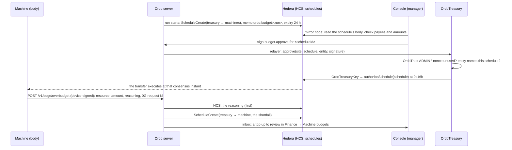

# Ordo on Hedera: run budgets the manager approves

Machines buy the resources their stages need with HBAR from their own native accounts. This document covers where that HBAR comes from:
- each org has a **treasury account**;
- a run's budget and every over-budget top-up leave the treasury as a **Hedera scheduled transfer**;
- the transfer executes only when one of the org's managers approves it.

It also explains why that part of Ordo is built on Hedera and cannot simply move to another chain, and what the testnet spike showed before any of it was built.

## Why Hedera is irreplaceable here

1. **The treasury is a contract key.**
   - The org's treasury account is keyed to a contract: its own `OrdoTreasuryKey`, created by `OrdoTreasury`.
   - HBAR leaves it only through a scheduled transaction that the contract signs, through the Schedule Service's `authorizeSchedule` (HIP-755), after `OrdoTreasury` verified a manager's EIP-712 signature.
   - No server holds a key that could overspend. The spike shows that the operator, which pays for every schedule, can neither move the treasury's HBAR nor sign its schedules.
2. **A pending purchase is a ledger object.**
   - A run budget or a top-up is a schedule with an expiry on the ledger (HIP-423), visible on HashScan.
   - It executes at the consensus instant the manager's approval lands, or it simply lapses at its expiry.
   - There is no Safe-style wallet and no keeper bot to execute it or to clean it up.
3. **Reasoning is ordered before approval.**
   - When a machine asks for more, its justification goes to the HCS topic first: reasoning, 0G request id and value at risk.
   - Only then is the top-up scheduled, so the consensus timestamp shows the reasoning predates the money.
4. **x402 with a protocol fee payer** (the resources batch).
   - Machines pay vendors in HBAR, and the facilitator co-signs as the fee payer.
   - Finality takes 3 to 5 seconds and fees are fixed in USD (about $0.0001 a transfer), so buying per resource is practical.
   - On an EVM chain, x402 needs token-specific authorizations (EIP-3009).
5. **A machine's balance is its hard cap.**
   - Machine accounts are native accounts, so no application code enforces the limit: a machine cannot spend what the manager did not fund.

Remove Hedera and you would need four trusted components in its place:
- a multisig contract wallet;
- a keeper bot for execution and expiry;
- an off-chain approval queue;
- a separate audit log.

On Hedera, protocol features do all four jobs.

## How it fits together



### The pieces

- **OrdoTreasury** (`contracts/src/OrdoTreasury.sol`): one deployment per Ordo instance.
  - It reads roles from OrdoTrust.
  - `openSite(siteId)` creates the org's `OrdoTreasuryKey` with CREATE2. The org's treasury account is keyed to that contract.
  - `approve(siteId, schedule, entity, sig)` does the following, in order:
    1. checks the signer is an ADMIN of that site in OrdoTrust, for the action `budget.approve`;
    2. checks the entity is `<scheduleId>#0x<64 hex>` for this very schedule;
    3. burns the nonce;
    4. asks the org's key to call `authorizeSchedule`.
  - A refusal from the Schedule Service reverts as `ScheduleRefused(code)` and keeps the nonce unused.
- **A key contract per org.** The Schedule Service signs with the contract that calls it.
  - A single shared key would let one org's manager approve another org's schedule.
  - With a key per org, an approval can only ever sign that org's schedules.
- **The hash in the entity.** A contract cannot read a schedule's body, so the manager's signature names it instead:
  - the hash is `sha256("ordo-budget|<treasury>|<account>:<tinybars>,…")`, with the credits sorted;
  - the console computes it from the mirror node's copy of the schedule, never from what the server says;
  - before asking for a signature, the console checks that the schedule debits only the treasury, pays exactly the credits shown, moves nothing else, and is neither executed nor deleted.
- **Server** (`server/src/core/budgets.ts`, `server/src/chain/treasury.ts`):
  - **Run budget.** At run start, ONE ScheduleCreate wraps a transfer of at most 9 credits. Each line is the stage's resources (quantity × max price, plus a margin), credited to the machine of the stage that buys them.
  - **Top-up.** It is for the shortfall above the machine's balance, capped at `TREASURY_TOPUP_MAX_TINYBARS`.
  - **The relayer** sends approvals to OrdoTreasury.
  - **Reconciliation.** The server records executed, deleted or expired states from the mirror node.
  - **Expired or declined top-ups** hold the dependent stage as "Not approved".
  - **Inert when unconfigured.** Without a treasury, all of this is inert, and machines spend only what their wallets hold.
- **Console** (Finance → Machine budgets): shows the following, with HashScan links:
  - the treasury's balance;
  - each run budget and its lines;
  - over-budget requests with their reasoning, 0G request id and value at risk;
  - Approve and Decline.

## What the testnet spike showed

The spike ran on testnet on 6 Nov 2026, before anything was built. The operator was `0.0.11022138`.

### 1. A contract can sign for an account keyed to it (HIP-755)

| Step | Result |
| --- | --- |
| Contract | `0.0.11328689` |
| Treasury account keyed to it | [`0.0.11328691`](https://hashscan.io/testnet/account/0.0.11328691). Mirror node key: `ProtobufEncoded 0a0518b1b9b305`, which is `Key{contractID: 0.0.11328689}` |
| Scheduled transfer from that account | [`0.0.11328693`](https://hashscan.io/testnet/schedule/0.0.11328693) |
| Contract calls `authorizeSchedule` | [`0.0.11022138@1793905215.034605248`](https://hashscan.io/testnet/transaction/0.0.11022138-1793905215-034605248): response code 22 (SUCCESS), 41,554 gas |
| Schedule | Executed at `1793905218.257554320`, about 3 s later |

The threshold-key fallback, where Ordo would hold an approver key, was therefore not needed. The doctor would flag such a key as a custodial fallback.

### 2. Only the account's own contract counts

| Step | Result |
| --- | --- |
| Another contract | `0.0.11328710`, with schedule [`0.0.11328712`](https://hashscan.io/testnet/schedule/0.0.11328712) |
| The wrong contract calls `authorizeSchedule` | [tx](https://hashscan.io/testnet/transaction/0.0.11022138-1793905255-917629437): code 22, **but the schedule did not execute**. Its signature is not the account's key. |
| The right contract calls `authorizeSchedule` | [tx](https://hashscan.io/testnet/transaction/0.0.11022138-1793905261-274400674): executed at `1793905269.018739294` |

`authorizeSchedule` returning SUCCESS means "signature added", not "transfer done". This is why the server records an approval as executed only once the mirror node says so.

### 3. The real contracts, end to end

This run used a throwaway OrdoTrust and OrdoTreasury, so the live OrdoTrust was untouched.

| Step | Result |
| --- | --- |
| OrdoTrust (throwaway) | [`0x1ba92c60…6ef4`](https://hashscan.io/testnet/contract/0x1ba92c601476345543e832983b68aaff2e1d6ef4) |
| OrdoTreasury (throwaway) | [`0xb7f44603…1dc8`](https://hashscan.io/testnet/contract/0xb7f446032e74b228fc086380c836880b19a51dc8) |
| `openSite` creates the org's key | [tx](https://hashscan.io/testnet/transaction/0x0b81e02ec941379cedab36bfbe47a250db34c784f97abc384201750d3a3ecc95), 209,081 gas: `OrdoTreasuryKey` `0xC4971dE7…D723` = [`0.0.11328860`](https://hashscan.io/testnet/contract/0.0.11328860) |
| Treasury account keyed to it | [`0.0.11328861`](https://hashscan.io/testnet/account/0.0.11328861), 3 HBAR |
| The operator transfers from the treasury directly | Refused: `INVALID_SIGNATURE` |
| Run budget: 1 HBAR to two machines (0.4 + 0.6) | Schedule [`0.0.11328864`](https://hashscan.io/testnet/schedule/0.0.11328864) |
| The operator signs the schedule | Refused: `NO_NEW_VALID_SIGNATURES` (the operator's key is not one the transfer needs) |
| Mirror node body, decoded | `0.0.11328861 −1 HBAR, 0.0.11328862 +0.4, 0.0.11328863 +0.6`, nothing else |
| A stranger's `budget.approve` | [Reverted](https://hashscan.io/testnet/transaction/0x55f8c77b705e1d093231b67449144e303d7cde080e42ee92bc62e75a85e5d00a) (`NotAuthorized`) |
| The site admin's `budget.approve`, sent by the relayer | [Success](https://hashscan.io/testnet/transaction/0xb47b21fb102115a821ce46cfb931a880ab91ba2b52403e612bca02017e74544a), 126,619 gas. The call went OrdoTreasury → OrdoTreasuryKey → `0x16b`. |
| Schedule | Executed at `1793906157.037978106`. Balances afterwards: treasury 2 HBAR, machines 0.4 and 0.6 HBAR. |

The nested call matters. The Schedule Service signs with the **immediate** caller, which is the org's key contract and not OrdoTreasury. Each org's key can therefore only sign its own treasury's schedules.

### 4. An unapproved schedule simply lapses

| Step | Result |
| --- | --- |
| Schedule with a 90 s expiry, left unapproved | [`0.0.11328873`](https://hashscan.io/testnet/schedule/0.0.11328873) |
| Mirror node after the expiry | `executed: null`, `deleted: false`, `expiration_time` in the past |
| `ScheduleInfoQuery` on the network | `INVALID_SCHEDULE_ID`: the schedule is gone |
| Treasury balance | Unchanged |

The server treats a pending schedule as expired once it is a minute past its expiry and neither executed nor deleted. That is when it holds the dependent stage.

## Live deployment

| What | Where |
| --- | --- |
| OrdoTreasury (testnet, 6 Nov 2026), against OrdoTrust v3 `0x9294c81d…32fc` | [`0xe90ec7e22864dca8cdcafc1e94d7f9e0b94dc1bb`](https://hashscan.io/testnet/contract/0xe90ec7e22864dca8cdcafc1e94d7f9e0b94dc1bb), deployed in [tx](https://hashscan.io/testnet/transaction/0x1f093a7e3c63a3c372b9e954154518ef023c9af44ee4a68f7ff1acb6483e523e) |

## Setting it up

1. **Deploy OrdoTreasury** against the OrdoTrust in `TRUST_CONTRACT_ADDRESS` (skip this step for the deployment above):
   ```sh
   cd contracts && TRUST_CONTRACT_ADDRESS=0x<OrdoTrust> pnpm setup:hedera treasury
   ```
   It prints `TREASURY_CONTRACT_ADDRESS`.
2. **Set these in the server's environment:**

   | Variable | Required | Default | What it is |
   | --- | --- | --- | --- |
   | `TREASURY_CONTRACT_ADDRESS` | yes | none | The OrdoTreasury above |
   | `TREASURY_BUDGET_MARGIN_PCT` | no | 10 | Margin on a run's resource costs |
   | `TREASURY_BUDGET_HOURS` | no | 24 | A schedule's expiry, at most 62 days |
   | `TREASURY_SEED_TINYBARS` | no | 0 | What the operator puts in a new treasury |
   | `TREASURY_TOPUP_MAX_TINYBARS` | no | 100 HBAR | The largest top-up a machine may ask for |

   It also needs:
   - the OrdoTrust settings on a Hedera chain: `TRUST_RPC_URL`, `TRUST_CONTRACT_ADDRESS`, `TRUST_RELAYER_KEY`;
   - the operator: `HEDERA_OPERATOR_ID`, `HEDERA_OPERATOR_KEY`;
   - `HEDERA_TOPIC_ID`, which carries the reasoning for top-ups.
3. **Open each org's treasury.** Use one of:
   - the console: Finance → Machine budgets → Open treasury;
   - the command line:
     ```sh
     TREASURY_CONTRACT_ADDRESS=0x<OrdoTreasury> pnpm setup:hedera treasury <siteId> 50
     ```
     It opens the org's key and creates the account with 50 HBAR. Link it in the console.

   Anyone can fund the treasury afterwards with a plain transfer.
4. **Check it.** In `server`, `pnpm run doctor` shows the **org treasury** rail. It confirms that:
   - the contract checks admins in the configured OrdoTrust;
   - every org's treasury is keyed to its own key contract, with no custodial fallback;
   - there is a topic for top-up reasoning.
