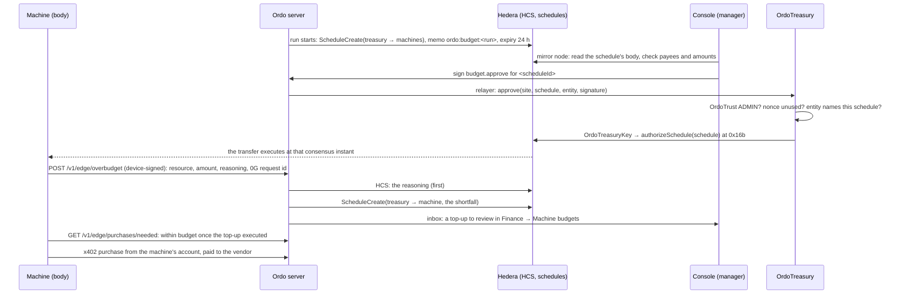

# Ordo on Hedera

Ordo runs a plant's production pipelines. Every stage runs on a machine, and every machine is an AI agent with its own body. On Hedera, Ordo does four kinds of work:

- **Money:** machine accounts, the org treasury, x402 purchases, Agent Kit escrow, stablecoin holds.
- **Records:** the HCS-anchored ledger and HCS audit lines.
- **Tokens:** lot passports as HTS NFTs, and the OUSD stablecoin.
- **Deadlines:** schedules that execute or lapse on the network, whether or not Ordo is running.

This page first maps every place Ordo uses Hedera, each confirmed in the code. It then goes deep on the most Hedera-native piece: run budgets the manager approves.

## One run, and every Hedera step in it

1. **The org gets its machines.** One manager signature creates every machine its templates need. Each machine gets its own Hedera account, an ECDSA account with an EVM alias, opened by the operator. A machine's balance is a hard cap on what it can ever spend. (`core/fleet.ts`, `core/machines.ts`, `chain/machine-bank.ts`)
2. **The run is funded from the treasury.**
   - When the run starts, its budget becomes one scheduled transfer from the org treasury to the machines that will buy.
   - The treasury is a native account keyed to the org's own contract. HBAR leaves it only when `OrdoTreasury` has checked a manager's signature and signs the schedule through the Schedule Service (HIP-755).
   - The console reads the schedule's body from the public mirror node before the manager signs.
   - (`core/budgets.ts`, `chain/treasury.ts`, `contracts/src/OrdoTreasury.sol`, `web/src/pages/MachineBudgets.tsx`)
3. **Machines buy what the next stages consume.**
   - Each machine pays the vendor's own account from its own account over x402, with no one approving each purchase.
   - Every sale is written to HCS, and the machine gets a delivery receipt signed by Ordo.
   - (`core/resources.ts`, `body/src/buy.ts`, `edge/purchasing.ts`)
4. **A machine that runs short asks.**
   - Its reasoning, 0G request id and value at risk go to HCS first. Only then is the shortfall scheduled from the treasury for a manager to approve.
   - Unapproved, the schedule lapses on the ledger (HIP-423), and Ordo deletes a top-up whose stage no longer needs it.
   - (`core/budgets.ts` `overBudget`)
5. **Stage deadlines run on Hedera.** Each stage's timeout is a scheduled topic message. Ordo deletes it when the stage finishes in time. (`core/schedules.ts`, `pipelines/engine.ts`)
6. **A drifting machine gets help.**
   - It buys a vibration assessment over x402 for 0.1 HBAR from its own account.
   - The maintenance agent escrows a vendor work order through the Hedera Agent Kit into `OrdoWorkOrders`. Three checks guard it: an Agent Kit policy, caps in the contract, and a person's signature to release. An HCS audit hook records every escrow call.
   - The refund is scheduled at the escrow's expiry.
   - (`chain/agent-kit.ts`, `core/workorders.ts`, `core/assessments.ts`, `chain/x402.ts`)
7. **People confirm the work.**
   - A contributor signs a proof of work. A validator who staked HBAR on `OrdoTrust` selects it, and the acceptance is recorded on Hedera.
   - Validator payouts are scheduled at the end of the unstake cooldown.
   - (`core/selection.ts`, `chain/trust.ts`, `contracts/src/OrdoTrust.sol`)
8. **The lot is a token.**
   - Each lot is an HTS NFT whose metadata is the public passport (HIP-412). The metadata is updated as the lot is held, completed or shipped (HIP-657), so its history on HashScan follows production.
   - On a signed ship, the NFT is airdropped to the customer (HIP-904).
   - (`chain/passport.ts`, `core/passports.ts`)
9. **The customer pays on proof.**
   - The lot's price sits in a Stablecoin Studio hold of OUSD, with `OrdoPayOnProof` as escrow. It pays out when `OrdoTrust` records the three-signature release, and refunds at expiry.
   - Before release, the plant can sell the receivable to a financier.
   - (`chain/payonproof.ts`, `core/finance.ts`, `contracts/src/OrdoPayOnProof.sol`)
10. **Everything is anchored.** The head of Ordo's hash-chained ledger goes to an HCS topic every few entries. Anyone can check a proof against the consensus timestamp, which cannot be back-dated. (`chain/hedera.ts`, `core/proof.ts`)

Outside a run, Ordo also sells three MCP tools at 0.1 HBAR a call over x402 (`chain/mcp.ts`, at `/v1/x402/mcp`).

## Every integration

All of them are assembled in `server/src/wiring.ts` (`buildSystem`). Each turns itself on when its env vars are set, and they are all on in local dev.

| Integration | Hedera services | What it does | Code |
| --- | --- | --- | --- |
| Org treasury | Contract-keyed account, Schedule Service (HIP-755, HIP-423), Mirror Node, HCS | Run budgets and top-ups as schedules a manager approves; no server key can move the HBAR | `chain/treasury.ts`, `core/budgets.ts`, `contracts/src/OrdoTreasury.sol` |
| Machine wallets | Accounts (ECDSA alias), crypto transfer, Mirror Node, HCS | One account per machine; the balance is its spending cap | `chain/machine-bank.ts`, `core/machines.ts`, `core/fleet.ts` |
| Resource purchasing | x402 (`@x402/hedera`), HBAR, HCS | Machines buy ahead from vendors' offers, paid to each vendor's account | `core/resources.ts`, `body/src/buy.ts` |
| Agent payments | Hedera Agent Kit (plugin, policy, HCS audit hook), Smart Contracts | The maintenance agent escrows work orders in `OrdoWorkOrders` | `chain/agent-kit.ts`, `core/workorders.ts` |
| x402 assessments | x402, HBAR | Ordo sells an assessment; the agent or a machine buys one per drift | `chain/x402.ts`, `core/assessments.ts` |
| Metered MCP | x402 over MCP, HBAR | Three paid tools, settled only when the tool succeeds | `chain/mcp.ts` |
| Hedera schedules | Schedule Service (HIP-423), Mirror Node | Escrow refunds, validator payouts and stage timeouts run by the network | `chain/hedera.ts`, `core/schedules.ts` |
| Lot passports | HTS NFT (HIP-412, HIP-657, HIP-904) | One NFT per lot; its metadata follows the lot; airdropped on ship | `chain/passport.ts`, `core/passports.ts` |
| Pay on proof | Stablecoin Studio holds, HTS fungible (OUSD), Smart Contracts, accounts with automatic associations | The customer's payment is held until the release is on-chain; receivables can be sold | `chain/payonproof.ts`, `core/finance.ts` |
| Ledger anchoring | HCS, Mirror Node | The ledger head is consensus-timestamped; proofs verify against it | `chain/hedera.ts`, `core/proof.ts` |
| HCS audit lines | HCS | Machine purchases, wallet openings, over-budget reasoning and Agent Kit calls each get a line | `core/resources.ts`, `core/budgets.ts`, `core/machines.ts` |
| Trust and policies | Smart Contracts on Hedera EVM (chain 296), HBAR stakes | Roles, validator stakes, rewards, cases, acceptances, lot releases, each line's autonomy policy | `chain/trust.ts`, `contracts/src/OrdoTrust.sol`, `OrdoPolicies.sol` |

## Where Hedera has the most impact, for the pitch

1. **The org treasury: no server can move the org's money.**
   - The treasury is a native account keyed to a contract, and HBAR leaves it only on a manager's verified signature (HIP-755).
   - The manager checks the payees against the public mirror node before signing.
   - This needs Hedera itself; it cannot be rebuilt on a generic EVM chain.
2. **Machines that pay for themselves.**
   - Every machine is an agent with its own account, buying what its next stages need over x402 within a balance the manager funded.
   - Each purchase is on HCS. When it runs short, its reasoning is on HCS before any money is scheduled.
3. **Agent Kit escrow with three locks.** The agent signs from its own account, but an Agent Kit policy, the contract's caps and a person's signature all stand between it and the vendor. An HCS hook audits every call.
4. **The lot as a token.** An HTS NFT per lot whose metadata follows production (HIP-657) and that lands with the customer (HIP-904). Its OUSD payment is held until the release is on-chain, and the receivable can be sold before then.
5. **Deadlines and records the network keeps.**
   - Refunds, payouts and stage timeouts are schedules the network executes, whether or not Ordo is running.
   - The ledger head and every agent decision that moves money carry consensus timestamps that cannot be back-dated.

Hedera tracks these fit:
- **AI and agentic payments:** points 1, 2 and 3.
- **Tokenization:** point 4.
- **Creative use of HCS:** reasoning ordered before money, stage timeouts as scheduled topic messages, and the anchored ledger.

### Hedera-only, or portable

- **Hedera-only:**
  - the treasury: a contract-keyed account plus `authorizeSchedule`;
  - every schedule;
  - HCS anchoring and audit lines;
  - HTS passports with metadata updates and airdrops;
  - native machine accounts as hard caps;
  - x402 with a protocol fee payer;
  - the Agent Kit policy and hooks;
  - Stablecoin Studio holds.
- **Portable Solidity, deployed on Hedera EVM:** `OrdoTrust`, `OrdoWorkOrders`, `OrdoPolicies` and `OrdoPayOnProof`.

Say this plainly in the pitch: the contracts hold the rules, and Hedera is what makes money move only when those rules and people say so.

## Run budgets the manager approves

Machines buy the resources their stages need with HBAR from their own native accounts. This section covers where that HBAR comes from:
- each org has a **treasury account**;
- a run's budget and every over-budget top-up leave the treasury as a **Hedera scheduled transfer**;
- the transfer executes only when one of the org's managers approves it.

It also explains why that part of Ordo is built on Hedera and cannot simply move to another chain, and what the testnet spike showed before any of it was built.

### Why Hedera is irreplaceable here

1. **The treasury is a contract key.**
   - The org's treasury account is keyed to a contract: its own `OrdoTreasuryKey`, created by `OrdoTreasury`.
   - HBAR leaves it only through a scheduled transaction that the contract signs, through the Schedule Service's `authorizeSchedule` (HIP-755), after `OrdoTreasury` verified a manager's EIP-712 signature.
   - No server holds a key that could overspend. The spike shows that the operator, which pays for every schedule, can neither move the treasury's HBAR nor sign its schedules.
2. **A pending purchase is a ledger object.**
   - A run budget or a top-up is a schedule with an expiry on the ledger (HIP-423), visible on HashScan.
   - It executes at the consensus instant the manager's approval lands, or it simply lapses at its expiry.
   - There is no Safe-style wallet and no keeper bot to execute it or to clean it up.
3. **Reasoning is ordered before approval.**
   - When a machine asks for more, its justification goes to the HCS topic first: reasoning, 0G request id and value at risk.
   - Only then is the top-up scheduled, so the consensus timestamp shows the reasoning predates the money.
4. **x402 with a protocol fee payer** (the resources batch).
   - Machines pay vendors in HBAR, and the facilitator co-signs as the fee payer.
   - Finality takes 3 to 5 seconds and fees are fixed in USD (about $0.0001 a transfer), so buying per resource is practical.
   - On an EVM chain, x402 needs token-specific authorizations (EIP-3009).
5. **A machine's balance is its hard cap.**
   - Machine accounts are native accounts, so no application code enforces the limit: a machine cannot spend what the manager did not fund.

Remove Hedera and you would need four trusted components in its place:
- a multisig contract wallet;
- a keeper bot for execution and expiry;
- an off-chain approval queue;
- a separate audit log.

On Hedera, protocol features do all four jobs.

### How it fits together



#### The pieces

- **OrdoTreasury** (`contracts/src/OrdoTreasury.sol`): one deployment per Ordo instance.
  - It reads roles from OrdoTrust.
  - `openSite(siteId)` creates the org's `OrdoTreasuryKey` with CREATE2. The org's treasury account is keyed to that contract.
  - `approve(siteId, schedule, entity, sig)` does the following, in order:
    1. checks the signer is an ADMIN of that site in OrdoTrust, for the action `budget.approve`;
    2. checks the entity is `<scheduleId>#0x<64 hex>` for this very schedule;
    3. burns the nonce;
    4. asks the org's key to call `authorizeSchedule`.
  - A refusal from the Schedule Service reverts as `ScheduleRefused(code)` and keeps the nonce unused.
- **A key contract per org.** The Schedule Service signs with the contract that calls it.
  - A single shared key would let one org's manager approve another org's schedule.
  - With a key per org, an approval can only ever sign that org's schedules.
- **The hash in the entity.** A contract cannot read a schedule's body, so the manager's signature names it instead:
  - the hash is `sha256("ordo-budget|<treasury>|<account>:<tinybars>,…")`, with the credits sorted;
  - the console computes it from the mirror node's copy of the schedule, never from what the server says;
  - before asking for a signature, the console checks that the schedule debits only the treasury, pays exactly the credits shown, moves nothing else, and is neither executed nor deleted.
- **Server** (`server/src/core/budgets.ts`, `server/src/chain/treasury.ts`):
  - **Run budget.** At run start, ONE ScheduleCreate wraps a transfer of at most 9 credits. The amounts come from `server/src/core/run-budget.ts`: each line is the stage's resources (quantity × max price), and each machine that buys them is credited its lines plus a margin.
  - **Top-up.** It is for the shortfall: what the purchase costs above the machine's balance, or above what the stage's max price allows, whichever is more. It is capped at `TREASURY_TOPUP_MAX_TINYBARS`, and one purchase has at most one top-up waiting for a manager.
  - **Buying after a top-up.** Once a top-up has executed, Ordo's list of what a machine should buy counts that offer as within budget, up to the purchase amount the manager approved, so the machine's body buys it on its next cycle (`server/src/core/resources.ts`).
  - **A machine without a 0G brain** still asks: its reasoning is its report of the facts, and the top-up records no 0G request id. The console and the inbox say so.
  - **The relayer** sends approvals to OrdoTreasury.
  - **Reconciliation.** The server records executed, deleted or expired states from the mirror node.
  - **Expired or declined top-ups** hold the dependent stage as "Not approved".
  - **Inert when unconfigured.** Without a treasury, all of this is inert, and machines spend only what their wallets hold.
- **Console** (Finance → Machine budgets): shows the following, with HashScan links:
  - the treasury's balance;
  - each run budget and its lines;
  - over-budget requests with their reasoning, 0G request id and value at risk;
  - Approve and Decline.

### What the testnet spike showed

The spike ran on testnet on 6 Nov 2026, before anything was built. The operator was `0.0.11022138`.

#### 1. A contract can sign for an account keyed to it (HIP-755)

| Step | Result |
| --- | --- |
| Contract | `0.0.11328689` |
| Treasury account keyed to it | [`0.0.11328691`](https://hashscan.io/testnet/account/0.0.11328691). Mirror node key: `ProtobufEncoded 0a0518b1b9b305`, which is `Key{contractID: 0.0.11328689}` |
| Scheduled transfer from that account | [`0.0.11328693`](https://hashscan.io/testnet/schedule/0.0.11328693) |
| Contract calls `authorizeSchedule` | [`0.0.11022138@1793905215.034605248`](https://hashscan.io/testnet/transaction/0.0.11022138-1793905215-034605248): response code 22 (SUCCESS), 41,554 gas |
| Schedule | Executed at `1793905218.257554320`, about 3 s later |

The threshold-key fallback, where Ordo would hold an approver key, was therefore not needed. The doctor would flag such a key as a custodial fallback.

#### 2. Only the account's own contract counts

| Step | Result |
| --- | --- |
| Another contract | `0.0.11328710`, with schedule [`0.0.11328712`](https://hashscan.io/testnet/schedule/0.0.11328712) |
| The wrong contract calls `authorizeSchedule` | [tx](https://hashscan.io/testnet/transaction/0.0.11022138-1793905255-917629437): code 22, **but the schedule did not execute**. Its signature is not the account's key. |
| The right contract calls `authorizeSchedule` | [tx](https://hashscan.io/testnet/transaction/0.0.11022138-1793905261-274400674): executed at `1793905269.018739294` |

`authorizeSchedule` returning SUCCESS means "signature added", not "transfer done". This is why the server records an approval as executed only once the mirror node says so.

#### 3. The real contracts, end to end

This run used a throwaway OrdoTrust and OrdoTreasury, so the live OrdoTrust was untouched.

| Step | Result |
| --- | --- |
| OrdoTrust (throwaway) | [`0x1ba92c60…6ef4`](https://hashscan.io/testnet/contract/0x1ba92c601476345543e832983b68aaff2e1d6ef4) |
| OrdoTreasury (throwaway) | [`0xb7f44603…1dc8`](https://hashscan.io/testnet/contract/0xb7f446032e74b228fc086380c836880b19a51dc8) |
| `openSite` creates the org's key | [tx](https://hashscan.io/testnet/transaction/0x0b81e02ec941379cedab36bfbe47a250db34c784f97abc384201750d3a3ecc95), 209,081 gas: `OrdoTreasuryKey` `0xC4971dE7…D723` = [`0.0.11328860`](https://hashscan.io/testnet/contract/0.0.11328860) |
| Treasury account keyed to it | [`0.0.11328861`](https://hashscan.io/testnet/account/0.0.11328861), 3 HBAR |
| The operator transfers from the treasury directly | Refused: `INVALID_SIGNATURE` |
| Run budget: 1 HBAR to two machines (0.4 + 0.6) | Schedule [`0.0.11328864`](https://hashscan.io/testnet/schedule/0.0.11328864) |
| The operator signs the schedule | Refused: `NO_NEW_VALID_SIGNATURES` (the operator's key is not one the transfer needs) |
| Mirror node body, decoded | `0.0.11328861 −1 HBAR, 0.0.11328862 +0.4, 0.0.11328863 +0.6`, nothing else |
| A stranger's `budget.approve` | [Reverted](https://hashscan.io/testnet/transaction/0x55f8c77b705e1d093231b67449144e303d7cde080e42ee92bc62e75a85e5d00a) (`NotAuthorized`) |
| The site admin's `budget.approve`, sent by the relayer | [Success](https://hashscan.io/testnet/transaction/0xb47b21fb102115a821ce46cfb931a880ab91ba2b52403e612bca02017e74544a), 126,619 gas. The call went OrdoTreasury → OrdoTreasuryKey → `0x16b`. |
| Schedule | Executed at `1793906157.037978106`. Balances afterwards: treasury 2 HBAR, machines 0.4 and 0.6 HBAR. |

The nested call matters. The Schedule Service signs with the **immediate** caller, which is the org's key contract and not OrdoTreasury. Each org's key can therefore only sign its own treasury's schedules.

#### 4. An unapproved schedule simply lapses

| Step | Result |
| --- | --- |
| Schedule with a 90 s expiry, left unapproved | [`0.0.11328873`](https://hashscan.io/testnet/schedule/0.0.11328873) |
| Mirror node after the expiry | `executed: null`, `deleted: false`, `expiration_time` in the past |
| `ScheduleInfoQuery` on the network | `INVALID_SCHEDULE_ID`: the schedule is gone |
| Treasury balance | Unchanged |

The server treats a pending schedule as expired once it is a minute past its expiry and neither executed nor deleted. That is when it holds the dependent stage.

## Live deployment

| What | Where |
| --- | --- |
| OrdoTreasury (testnet, 6 Nov 2026), against OrdoTrust v3 `0x9294c81d…32fc` | [`0xe90ec7e22864dca8cdcafc1e94d7f9e0b94dc1bb`](https://hashscan.io/testnet/contract/0xe90ec7e22864dca8cdcafc1e94d7f9e0b94dc1bb), deployed in [tx](https://hashscan.io/testnet/transaction/0x1f093a7e3c63a3c372b9e954154518ef023c9af44ee4a68f7ff1acb6483e523e) |

## Setting it up

1. **Deploy OrdoTreasury** against the OrdoTrust in `TRUST_CONTRACT_ADDRESS` (skip this step for the deployment above):
   ```sh
   cd contracts && TRUST_CONTRACT_ADDRESS=0x<OrdoTrust> pnpm setup:hedera treasury
   ```
   It prints `TREASURY_CONTRACT_ADDRESS`.
2. **Set these in the server's environment:**

   | Variable | Required | Default | What it is |
   | --- | --- | --- | --- |
   | `TREASURY_CONTRACT_ADDRESS` | yes | none | The OrdoTreasury above |
   | `TREASURY_BUDGET_MARGIN_PCT` | no | 10 | Margin on a run's resource costs |
   | `TREASURY_BUDGET_HOURS` | no | 24 | A schedule's expiry, at most 62 days |
   | `TREASURY_SEED_TINYBARS` | no | 0 | What the operator puts in a new treasury |
   | `TREASURY_TOPUP_MAX_TINYBARS` | no | 100 HBAR | The largest top-up a machine may ask for |

   It also needs:
   - the OrdoTrust settings on a Hedera chain: `TRUST_RPC_URL`, `TRUST_CONTRACT_ADDRESS`, `TRUST_RELAYER_KEY`;
   - the operator: `HEDERA_OPERATOR_ID`, `HEDERA_OPERATOR_KEY`;
   - `HEDERA_TOPIC_ID`, which carries the reasoning for top-ups.
3. **Open each org's treasury.** Use one of:
   - the console: Finance → Machine budgets → Open treasury;
   - the command line:
     ```sh
     TREASURY_CONTRACT_ADDRESS=0x<OrdoTreasury> pnpm setup:hedera treasury <siteId> 50
     ```
     It opens the org's key and creates the account with 50 HBAR. Link it in the console.

   Anyone can fund the treasury afterwards with a plain transfer.
4. **Check it.** In `server`, `pnpm run doctor` shows the **org treasury** rail. It confirms that:
   - the contract checks admins in the configured OrdoTrust;
   - every org's treasury is keyed to its own key contract, with no custodial fallback;
   - there is a topic for top-up reasoning.
