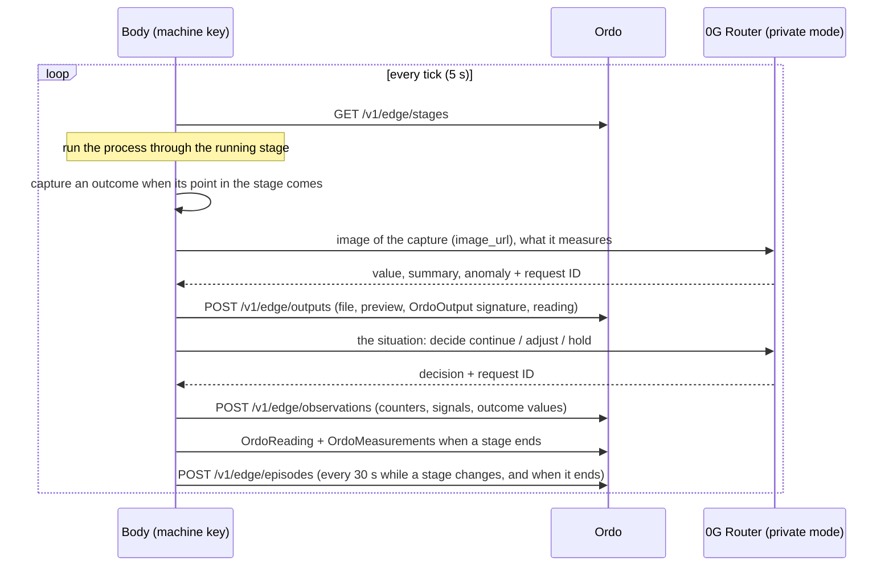

# Machines and their bodies

Every stage runs on a machine. A real machine reaches Ordo through MTConnect, a dataset, manual readings, or a signing gateway next to it. A **virtual machine** is a machine Ordo simulates: an asset run by its own **body**, a small program with the machine's key that talks to Ordo only over the signed edge channel, exactly as a gateway beside a real machine would. Everything a virtual machine produces says it is simulated.

## What a body does



- **Process.** Each kind of machine has a process model (`server/src/edge/profiles.ts`): its signals with units and warn and alarm limits, the tone its vibration carries, and the agent that owns it. The body counts units through the stage over `BODY_STAGE_S` seconds and keeps its signals in band; now and then a stage brings a drift toward a signal's warn limit, which its agent can notice and adjust.
- **Captures.** Each outcome of the stage is captured once, at a point spread through the stage, unless the agent asks for it again. The value is mostly in spec and occasionally out. The media is drawn so the value is the value on it: a thermal image in ironbow with a scale bar, a micrograph, CT slice or C-scan, a WAV recording with a spectrogram, an MP4 with its keyframe, a spectrum as CSV with its chart, a PDF report with a page preview. Video needs ffmpeg (the optional `ffmpeg-static` package, `BODY_FFMPEG`, or ffmpeg on PATH); without one, video outcomes are skipped with the reason in the log, never faked.
- **Signing.** The file is signed as an OrdoOutput (its SHA-256, the lot, stage and outcome, the value × 10⁴, the capture time), and the upload is signed like every edge request. The value also goes into the body's telemetry, so when the stage ends the body signs the outcome's measurement with the stage's counts.
- **The last unit waits.** A stage closes on its count, and its criteria are judged then, so the body holds back its last unit until the required outcomes are uploaded (and, with a brain, until its agent's closing decision).
- **Buying ahead.** When a stage starts, and about once a minute while the body runs, it asks Ordo (`GET /v1/edge/purchases/needed`) what the stages after its running one still need, and what its own stage waiting to start needs. It buys each from the cheapest vendor over x402 on Hedera, paid from the machine's own account (`MACHINE_ACCOUNT_ID` and `MACHINE_ACCOUNT_KEY`), and never pays more than Ordo quoted for it (`body/src/buy.ts`, `server/src/edge/purchasing.ts`). A purchase above the stage's max price, or above what the machine holds, is over budget: the body asks the org treasury for a top-up (`POST /v1/edge/overbudget`) with a short justification its 0G agent writes, or, without a brain, with the facts and no 0G request id. It asks once per purchase until that purchase resolves. When the manager approves and the top-up executes on Hedera, Ordo counts the offer within budget up to the amount approved, and the body buys it on its next cycle. A body without a machine account buys nothing and says so once in its log; a safe-stopped body does not buy.

## Roles

A machine does only what its roles allow. Each role is an ENS role name the machine holds, under its org: `cnc-07.runners.acme.ordo.eth`, `cnc-07.attesters.acme.ordo.eth`, `cnc-07.buyers.acme.ordo.eth` (slots 9 to 11 of `OrdoNames`), owned by the machine's device key. A machine without a key of its own gets names Ordo holds for it, and can be a Runner and a Buyer but never an Attester.

| Role | What it allows | Records on the name |
| --- | --- | --- |
| **Runner** | Ordo gives it stages of the kinds listed, and no others. A stage with no Runner for its kind waits, and says so. | `com.ordo.kinds` (`cnc,robot`) |
| **Attester** | Its key signs readings, measurements, outputs and edge stage polls, for the stages it runs only. Once OrdoRunResolver v2 is deployed, the chain checks the same for the runs recorded on it. | none |
| **Buyer** | It buys a stage's resources over x402 and asks for top-ups, within each stage's max price (or an approved top-up) and its own caps, if it has any. | `com.ordo.cap.order`, `com.ordo.cap.daily` (tinybar), when set |

**Granting.** On the Floor, a manager opens a machine and signs each change in its Roles section (an OrdoSignature `machine.role.grant` or `machine.role.revoke` whose entity carries the kinds or caps, so the signature covers them). A grant, a new kind, or a higher cap counts once the role name says so on ENS, about a minute; a removal, a dropped kind or a lower cap counts at once. Until then the drawer shows the role as *pending on ENS*. With ENS off, a signed change counts straight away.

**Without a signature.** A new machine is a Runner for its own kind, and an Attester when it has its own key. A machine wallet's first opening makes the machine a Buyer with no caps of its own (the wallet's per-purchase limit is for callouts such as condition assessments, not for a stage's resources); pausing the wallet takes Buyer away, and resuming it does not give it back (a manager grants it again). Migration 38 gave every machine what it could already do before roles existed (39 took back the Buyer caps 38 had copied from the wallet's callout limits).

**Buying with a ticket.** `GET /v1/edge/purchases/needed` lists only what a Buyer may buy, with its per-order cap and what is left of its day, and a ticket for each item: an HMAC over machine, run, stage and resource, valid an hour. The storefront sells a stage's resource only with that ticket, only to a Buyer, within its caps, and at or below the stage's max price unless a top-up was approved; a sale counts against the machine's day when it is sold, and a payment from another account is flagged (`resource.payer_mismatch`). A body skips a purchase over a cap with the reason: a manager raises the cap, a top-up would not help.

**Chain wins.** Every 5 minutes Ordo reads the role names back from ENS. A name taken away on-chain ends the role; an expired one is issued again.

**One key, one attester.** Each machine label holds one name per account on-chain, so when one device key feeds several machines only one of them can attest on-chain. The drawer warns; give each machine its own gateway or body.

```
GET  /v1/sites/:id/assets/:assetId/roles                     (level 2)
POST /v1/sites/:id/assets/:assetId/roles/sign-request        { role, grant, kinds?, order?, daily?, chainId? }   manager
POST /v1/sites/:id/assets/:assetId/roles                     { role, grant, kinds?, order?, daily?, nonce, signature }
```

## 0G in the loop

When Ordo has a 0G Router management key, each start of a body mints it a private-mode inference key (TEE providers only, seven days, revoked when the body stops). The body's agent then:

- **perceives** every capture: it sends the image the capture is (or its spectrogram, keyframe, chart or page) as an `image_url` and gets back the value it reads, a summary and any anomaly. That reading, with the 0G request ID, model, provider and whether the Router verified the TEE, is uploaded beside the output and shown at level 3. The instrument's value is the one signed; a reading that disagrees is noted as an anomaly.
- **decides** every 30 seconds while a stage runs, after each perception, and once before the stage's last unit: carry on, adjust (bring a drifting signal back, capture an out-of-spec outcome again) or hold the stage for a person. A hold is taken only when a capture is out of spec or a signal is at its warn limit, at most once a stage.

Without a Router configured the body runs without a brain: captures go up unread, the analysis says there is no 0G brain, and decisions are not made.

## Safe stop

A body with a brain never decides without it. After three 0G failures in a row (`BODY_FAIL_LIMIT`) it holds its running stage over `POST /v1/edge/hold` (`kind: safe_stop`; the engine records the hold by `machine:<device>`), stops its process (`FEED_HOLD`) and reports itself safe-stopped. It tries the Router every 30 seconds; when 0G answers it runs again, but the stage stays held until a person releases it from Approvals.

## The episode log

Every capture (with everything it was rendered from), perception, decision, hold, purchase (bought, skipped, or over budget with the top-up it asked for) and 0G failure is an entry in the body's episode log, with the 0G request ID where there is one. The body keeps it on its own disk (`BODY_DATA_DIR/episode.jsonl`) and posts each stage's episode to Ordo, which stores it, records `machine.episode_logged` on the ledger with the request IDs, and copies it to 0G Storage when that rail is on (at the end of a stage, and at most every five minutes otherwise). Level 3 opens it from the Floor.

**Replay.** `ordo-body replay <episode> [dir]` (or `pnpm --filter @ordo/body replay <episode>`) renders every capture in a log again from the seed and what the log recorded, writes the files, and checks each against the SHA-256 the machine signed. Images, audio, spectra and documents come out byte for byte; video matches on the same ffmpeg build. It reads the body's `episode.jsonl` or an episode downloaded from Ordo.

**Asking.** A body answers questions on `GET /ask?q=` (bearer token from Ordo): through its agent from the log, citing request IDs, or plainly from the log without a brain. Ordo asks it from the machine's drawer (`POST /v1/sites/:id/machines/:assetId/ask`), and the proof-of-work interviewer asks it about the stage it ran.

## Runtimes

`BODY_RUNTIME` picks where bodies run:

| Value | Where | Notes |
| --- | --- | --- |
| `off` (default) | nowhere | Virtual machines can be created; their bodies do not run. |
| `local` | a Node process per machine on the Ordo host | Spawns `body/dist/body.mjs` (`BODY_BUNDLE`), restarts it with backoff (1 s to 30 s), starts every running body again when Ordo restarts. The body reaches Ordo on loopback (`BODY_ORDO_URL` overrides) and keeps its log under `DATA_DIR/bodies/<asset>` (a temporary directory with `DATA_DIR=memory`). Build it first: `pnpm --filter @ordo/body build` (`pnpm dev` and `pnpm build` do). |
| `sandbox` | a Vercel Sandbox microVM per machine | `VERCEL_TOKEN`, `VERCEL_TEAM_ID`, `VERCEL_SANDBOX_PROJECT`; the body reaches Ordo at its public URL. |

Bodies start when a virtual machine is created, and again ahead of their stage: when a run reaches the stage before the machine's own (or its own stage is running and its body is not), Ordo starts the body. A body a person stopped stays stopped until started again; a failed body waits for a person.

## Creating one

**All at once, when an org is created.** Right after creating an org (and signing its OrdoTrust registration), the manager is shown the machines the high-value templates need: per kind, the most stages any one of them has of it, so a run of any template never waits for a machine (today 2 robot cells, 5 process vessels, 2 CNC machines, 5 inspection stations, 2 manual stations, 1 packing line). One `machines.fleet` signature, which names exactly the machines it creates, creates them all, each with its own device key and Hedera account; their bodies start when a run reaches their stages. The Floor offers the same while any are missing (`GET /v1/sites/:id/machines/fleet`, `POST …/machines/fleet/sign-request`, `POST …/machines/fleet {nonce, signature}`).

One at a time: on the Floor, **Create a virtual machine** (name, kind, zone). In the builder, a stage whose kind of machine the org does not have offers to create one and pins the stage to it. Over the API:

```
POST /v1/sites/:id/machines            { "name": "Inspection VM", "kind": "inspection", "zoneId": null }
GET  /v1/sites/:id/machines            the virtual machines with their body status
POST /v1/sites/:id/machines/:assetId/start | /stop
GET  /v1/sites/:id/machines/:assetId/episodes      (level 3)
GET  /v1/sites/:id/machines/:assetId/episode?sha256=
POST /v1/sites/:id/machines/:assetId/ask         { "question": "…" }
```

The machine's key is generated by Ordo and kept sealed (`machine_bodies`); its address is the asset's gateway device. When machine wallets are on, the machine also gets its own Hedera account, which the body is given at start.

## Body environment

| Variable | What |
| --- | --- |
| `ORDO_URL`, `BODY_KEY`, `BODY_ASSET`, `BODY_PROFILE`, `BODY_SEED` | Where Ordo is, the machine's key, its asset, its kind and the seed its process and media come from |
| `BODY_ASK_PORT`, `BODY_ASK_TOKEN`, `BODY_ASK_HOST` | Where it answers questions; loopback when Ordo is on loopback, every interface otherwise |
| `BODY_DATA_DIR` | Its own disk: the episode log and its counters, so a restarted body carries on |
| `BODY_STAGE_S`, `BODY_TICK_S`, `BODY_DECIDE_S`, `BODY_BUY_S`, `BODY_FAIL_LIMIT` | Seconds over a stage, between ticks (5), between decisions and between buying-ahead cycles; 0G failures before a safe stop (3). Ordo starts its bodies at a demo pace: 10 s a stage, a tick every 3 s, a decision every 10 s (each a 0G Router call) and a buying cycle every 5 s (server `BODY_STAGE_S`, `BODY_TICK_S`, `BODY_DECIDE_S`, `BODY_BUY_S`) |
| `ZG_ROUTER_URL`, `ZG_ROUTER_KEY`, `ZG_ROUTER_MODEL` | The 0G Router and the key minted for this start; unset, the body has no brain |
| `HEDERA_NETWORK`, `MACHINE_ACCOUNT_ID`, `MACHINE_ACCOUNT_KEY` | The machine's own account, which pays vendors over x402 |
| `BODY_FFMPEG` | An ffmpeg binary for video |

## Vercel Sandbox runtime

With `BODY_RUNTIME=sandbox`, each machine's body runs in its own [Vercel Sandbox](https://vercel.com/docs/vercel-sandbox): a Firecracker microVM that Ordo starts, wakes and stops. This is how production runs bodies: the Docker image carries the body bundle in `/app/body` (`ORDO_BODY_DIR`), and the Vercel build (`scripts/vercel-build.mjs`) builds it and ships it inside the API function, next to the server bundle. `BODY_RUNTIME=local` (a process per machine on the Ordo host) is for development and tests. The runner is `SandboxBodies` in `server/src/core/bodies-sandbox.ts`.

### One sandbox per machine

- **Name:** `ordo-<site>-<asset>`, lowercase, e.g. `ordo-site-3f9a0c1d2e4b-ast-7c2d9e0f1a3b`. Tags `app=ordo`, `site`, `asset`, so Ordo finds a machine's sandbox again after it restarts.
- **Machine:** image `vercel/sandbox/node:22`, 2 vCPUs with 4 GB of memory, region `iad1` (Vercel's default, next to the Render service in `virginia`).
- **Persistent:** the sandbox keeps its disk between sessions. Stopping it snapshots the disk, and the next start resumes from the newest snapshot. It keeps the last two snapshots.

### What happens on a start

1. Ordo gets the machine's sandbox, or creates it.
2. **First boot, or a new body bundle** (detected by the bundle's sha256): Ordo uploads `body/dist` (without source maps) to `ordo-body` in the sandbox's working directory (`/vercel/sandbox/ordo-body`), with a `package.json` of the body's npm dependencies and optional dependencies, such as `ffmpeg-static` (workspace code is bundled into `body.mjs`). It runs `npm install` and stops the sandbox once, which snapshots the installed body. Later starts skip the install.
3. Ordo ends a body that an earlier Ordo process left running, then runs `node body.mjs` detached, with the start's `BodyEnv` as its environment. `BODY_DATA_DIR` points at `ordo-body/data`, so the episode log survives stops and new bundles.
4. `BODY_ASK_PORT` (8787 unless the start says otherwise) is public at `https://<subdomain>.vercel.run`: that is the start's `askUrl`, where Ordo asks the body about its run (`GET /ask`).
5. A body that exits within 3 seconds fails the start, with its last lines of output in the error.

On a **stop**, Ordo sends the body SIGTERM so it can flush its episode log, waits up to 5 seconds, and stops the sandbox, which snapshots it again.

### Idle stop and session time

A sandbox session lasts 45 minutes, which fits every Vercel plan. The body service calls `sweep(lastActive)` every engine cycle:

- it stops a body with no activity for 15 minutes (`IDLE_STOP_MS`);
- it extends the session of every other body by 30 minutes whenever less than 15 are left, up to the plan's limit (45 minutes on Hobby, 24 hours on Pro).

### Setup

1. **A project for the sandboxes.** In the Vercel dashboard, create an empty project named `ordo-machines` in your team (it needs no repository and no deployment), or run `npx vercel project add ordo-machines --scope <team>`.
2. **A token.** At [vercel.com/account/settings/tokens](https://vercel.com/account/settings/tokens), create a token scoped to that team.
3. **Settings,** in Render (**ordo → Environment**) and in `server/.env` to try it locally:

   | Variable | Value |
   | --- | --- |
   | `BODY_RUNTIME` | `sandbox` (set by `render.yaml`) |
   | `VERCEL_TOKEN` | the token (sensitive) |
   | `VERCEL_TEAM_ID` | **Team Settings → General → Team ID** (`team_…`) |
   | `VERCEL_SANDBOX_PROJECT` | `ordo-machines` (its name or `prj_…` ID) |

4. **A public Ordo.** Bodies call Ordo at its public address (`PUBLIC_URL`, else `RENDER_EXTERNAL_URL`), never at `localhost`. To try sandboxes from a laptop, expose the dev server with a tunnel and set `PUBLIC_URL` to it.
5. **Check it:** `pnpm env:doctor`. The rail "vercel sandbox" checks that the token reaches the team, that the project exists, and lists the machine sandboxes and which are running. It warns when Ordo has no public address.

Without the three `VERCEL_*` values, Ordo starts with the warning "BODY_RUNTIME=sandbox needs …" and machine bodies don't run.

### Inspecting and troubleshooting

- **Sandboxes and sessions:** the `ordo-machines` project in the Vercel dashboard, or the `sandbox` CLI (`npx sandbox --help`).
- **A body's output:** the runner keeps each body's newest 200 lines (`logs(assetId)`); a failed start includes the last lines in its error.
- **"npm install failed":** the error carries npm's last lines. The sandbox has full internet access by default; `ffmpeg-static` downloads its binary while installing.
- **A snapshot expired:** the next start creates the sandbox again and reinstalls the body (slower, nothing to do).
- **Code:** `sandboxBodies(cfg)` builds the runner (null, with a warning, until the settings are complete); `listBodySandboxes(creds)` lists every machine sandbox with its state, for the doctor and the Floor.
