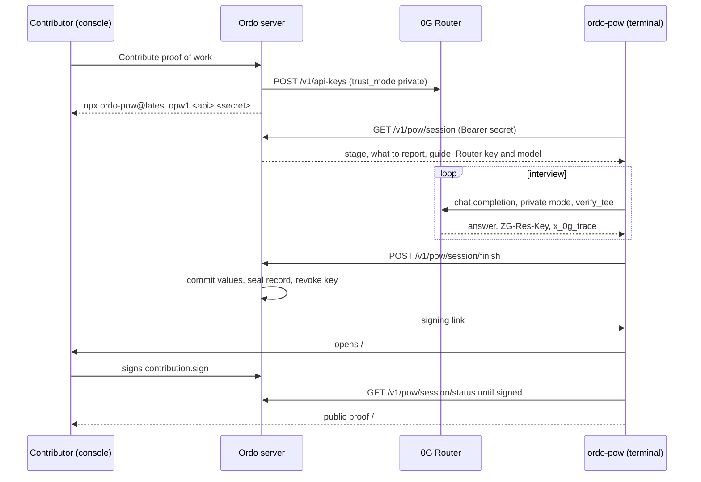

# Proof of work

How Ordo records who did the work on a stage and what they measured, how a validator picks the valid record, how a tester challenges that choice, and how a stage's numbers are proven in zero knowledge and bound into the lot's release. "Proof of work" here means evidence of manufacturing work, not mining.

## Roles

| Role | In proof of work |
| --- | --- |
| Contributor | Anyone who joins an open org. Records proof of work on a stage through the terminal agent and signs it. |
| Validator | Stakes. Selects the valid proof of work for a stage, never their own. Can contribute too. |
| Tester | Stakes. Opens a case against the validator who selected a proof of work. |
| Manager | Every right. Funds the reward pool, changes the reward and slashing settings, decides cases, reads sealed records. Can select (with OrdoTrust v3, only with an active stake) and contribute. |

What a member sees depends on their level and scope (below and in the Team page). Defaults: contributor 2, validator 3, tester 3, manager 4.

## Recording proof of work



1. **Join.** Any signed-in wallet joins an open org as a contributor (`POST /v1/orgs/:siteId/join`; `GET /v1/orgs` lists open orgs). Orgs are open by default. When a manager closes one, only a manager adds people.
2. **Start a session.** A stage takes proof of work once it has started (not queued or skipped) until a validator selects one. A member at level 2 or more, with the stage in their scope, opens it and clicks **Contribute proof of work** (`POST /v1/sites/:siteId/pow/sessions` with `{ runId, stage }`). Ordo:
   - cancels that person's earlier open session on the same stage;
   - mints a Router key with its management key: `POST /v1/api-keys` with `trust_mode: "private"`, the models it allows (the chat model, plus the speech-to-text model when one is set), an expiry at the session's end, and `ZG_ROUTER_CREDIT_LIMIT` as its cap when set;
   - keeps a hash of a new random secret, and the Router key sealed with the org's key;
   - shows `npx ordo-pow@latest opw1.<base64url(apiBase)>.<secret>`.

   A session lasts `POW_SESSION_MINUTES` (120 by default). `apiBase` is the deployment's public address: `PUBLIC_URL` when set, else `RENDER_EXTERNAL_URL` (Render), else on a Vercel preview that preview's own URL (`VERCEL_BRANCH_URL`, else `VERCEL_URL`), else in production `VERCEL_PROJECT_PRODUCTION_URL`, else the address the console was opened at. A session started on a preview therefore prints a command that talks to that preview. The Router key is not in the command: the agent fetches it with the secret. `GET .../pow/sessions` lists a person's sessions; `DELETE .../pow/sessions/:id` cancels one and revokes its key.
3. **Interview.** `ordo-pow` (the `sdk/` package: Node 22, no dependencies; see [sdk/README.md](../sdk/README.md)) calls `GET /v1/pow/session` with `Authorization: Bearer <secret>`. It gets the org, the stage, what to report (`Good units`, `Scrap units`, and each of the stage's criteria and parameters with its target), an interview guide, and the Router's URL, key and model. It interviews the contributor through the Router. Every request carries `x-0g-provider-trust-mode: private` (TEE providers only) and `verify_tee: true`. The model records answers with tool calls: `record_measurement`, `note`, `attach_evidence`, `finish`, and on a stage with outcomes `review_outcome`, `confirm_outcome` and (when the machine has a running body) `ask_machine`.
   - Evidence files are hashed on the contributor's machine (SHA-256, up to 50 MB each) and never uploaded to Ordo. With the contributor's consent, per file, a photo (up to 5 MB) is shown to the interviewer model and a voice note (up to 12 MB) is transcribed by the session's speech-to-text model (`ZG_ROUTER_AUDIO_MODEL`, `whisper-large-v3` on mainnet), both through the Router in private mode. Anything else stays hash-only.
   - The machine's outcomes: the session lists each of the stage's outcomes with its latest capture (version, MIME type, size, SHA-256, value, the machine's key and its 0G reading). `review_outcome` downloads the file (`GET /v1/pow/session/outputs/:key`, or `/:key/preview` for a video keyframe or an audio spectrogram; `?version=` picks a version), checks it against the signed hash and shows it to the model; `confirm_outcome` records the contributor's verdict (`confirm`, `dispute` with what they observed, or `unsure`). The agent will not finish until every required outcome the machine captured is confirmed or disputed. `ask_machine` posts `{ question }` to `POST /v1/pow/session/ask-machine`, which relays it to the machine's body (503 when it has none) and returns `{ question, answer, requestId, model, at, machine }`; at most 30 per session, kept with the session.
   - For every answer the agent keeps a receipt: `ZG-Res-Key`, the request id, the provider, `tee_verified`, the model, and SHA-256 of the exact request and response bytes.
   - The contributor sees the whole record and confirms it before anything is sent. The agent posts it to `POST /v1/pow/session/finish`.
4. **Commit and seal.** Ordo checks that each value names a criterion or parameter of the stage and is non-negative, and that counts are whole numbers. It commits each value as `Poseidon(subject, value × 10⁴, salt)`, with `subject = sha256("ordo:spec:<runId>:<stageCode>:<label>")` mod the BN254 field: the commitment the spec-check circuit opens. It checks each confirmation against the stage's outputs (the outcome exists, the hash is one of the versions the machine signed, `confirm` needs a hash). It seals the full record (values and salts, summary, notes, evidence hashes, the machine's media hashes and the contributor's verdicts, voice-note transcripts, the machine's answers, transcript, receipts) with the org's key and keeps its SHA-256 (record version 2 when it binds machine media). It revokes the session's Router key and returns the signing link `<console>/#/pow/<id>/sign?site=<siteId>`.
5. **Sign.** The agent prints the link and opens it. The contributor reviews the record and signs an EIP-712 `OrdoSignature`: action `contribution.sign`, entity `<id>#sha256:<hex>` (the record's hash). Ordo writes a `contribution.signed` ledger entry with the record hash, the commitments, the evidence hashes, each bound machine output (`{ outcome, sha256, verdict }`) and the TEE summary. The values and the conversation are not in the ledger. With `EVIDENCE_STORE=0g`, the sealed record is also copied, encrypted, to 0G Storage.
6. **Proof link.** The agent polls `GET /v1/pow/session/status` (every 3 seconds, up to 30 minutes) and, once the record is signed, prints the public proof `<console>/#/pow/<id>` (data: `GET /v1/public/contributions/:id`). Ctrl-C while waiting is safe: the same command resumes, and a session submits only once.

A stage takes any number of proofs of work, several from one person included. An unsigned record is visible only to its author. The engine cycle expires sessions past their time and revokes any key still open.

## Public and private

| Who | Sees |
| --- | --- |
| Anyone with the proof link | Contributor, org, order, stage, times, status and selection; each value's commitment and subject; evidence names, sizes and hashes (and whether 0G saw the file); the hashes of the machine's media the record binds, without the verdicts; the TEE summary and each turn's receipt (provider, model, `ZG-Res-Key`, request id, `tee_verified`, request and response hashes); the contributor's signature and the typed data it signed; the ledger entry; the 0G Storage copy. Never the values, the summary or the conversation. |
| A member at level 1 or 2 | Their own records in full. Other people's signed records only through their public proofs. |
| A member at level 3 or 4, stage in scope | Every signed record on the stage, with its values, notes and the agent's summary; the contributor's verdict on each machine outcome (disputes are flagged where a validator selects), voice-note transcripts, the machine's answers, and the bound media (`GET .../contributions/:id/outcomes`, `.../outputs/:key/file` or `/preview`). |
| The manager | The sealed record: values, salts, transcript and receipts (`GET /v1/sites/:siteId/contributions/:id/record`). |
| The tester of an open case | The same sealed record through the case (`GET .../cases/:id/record`), until the case is decided. |

A proof reads "All N turns TEE-verified" only when every receipt says `tee_verified: true`. Ordo records the Router's verdict; it does not re-check provider signatures itself. Each receipt keeps `ZG-Res-Key` and the provider, so anyone can check a turn's signature against the provider's on-chain TEE signer ([sdk/README.md](../sdk/README.md#verifiability)).

## Selection

A validator with an active stake, or a manager, at level 3 with the stage in scope, selects one signed proof of work as the valid one. With OrdoTrust v3 a manager needs an active stake too: the selection is the on-chain acceptance, and the contract records it only from a staked validator. Without OrdoTrust nobody stakes, and validators and managers select on their role. Nobody selects their own. They sign `contribution.select` with entity `<id>#<contributorAddress>`, with an optional comment (`POST .../contributions/:id/select/sign-request`, then `POST .../contributions/:id/select`). Ordo then:

- marks it selected, marks every other signed record on the stage "not selected", and closes open sessions on the stage;
- if the stage is running, records its counts and measured parameters from the selected record and completes it;
- commits those values itself: the stage's criteria are proven in zero knowledge over Ordo's own commitment, and the passport shows each proof as "value committed by Ordo" (signer kind `ordo`). A person's report is not a device-signed reading, so a selected proof of work's values are committed by Ordo, not signed as a reading; the contributor's signature stays on the sealed record;
- writes `contribution.selected` to the ledger;
- with OrdoTrust v3, relays the same signature to `recordAcceptance`: the contributor's reward and the validator's fee are reserved from the pool and vest after the challenge window.

A stage with a selected proof of work takes no more.

## Cases

A tester with an active stake examines selected proofs of work. `GET .../cases/candidates` lists them, the ones whose stage went wrong first: closed with a deviation, held, or missed a criterion.

1. **Open.** The tester writes the evidence (10 to 8000 characters) and proposes a cut of the validator's stake, between 0.01% and `maxSlashBps` (50% by default; the console starts at `defaultSlashBps`, 30%). They sign `case.open` with entity `<validator>#<bps>#<caseId>#0x<sha256(evidence)>`. A proof of work has one open case at a time, and its validator cannot open one against it. With OrdoTrust v3, Ordo first checks that the chain holds the selection's acceptance, unsettled, not frozen by another case and still inside its challenge window; otherwise it refuses (409) before anything is signed. The validator must answer within the response window.
2. **Respond.** The validator answers before the deadline and signs `case.respond`, entity `<caseId>#0x<sha256(response)>`.
3. **Decide.** A manager who is neither party upholds or rejects, signing `case.decide` with entity `<caseId>#uphold` or `<caseId>#reject`. They can decide once the validator answered or the window closed.

Each step is in the ledger (`case.opened`, `case.responded`, `case.upheld`, `case.rejected`). `GET .../cases` lists the cases a person opened or is accused in, and every case for a manager. With OrdoTrust v3 each signature is relayed (`openCase`, `respond`, `decideCase`) and the contract moves the money:

- **Upheld.** `bps` of the validator's stake is cut. `bountyBps` of the cut (50%) is credited to the tester; the rest goes to the org's quality fund. The challenged acceptance loses the validator's fee, which returns to the pool; the contributor keeps the reward.
- **Rejected.** `falseClaimBps` (10%) of the tester's stake is credited to the validator.

On-chain a case freezes the acceptance it names until the decision. Neither party can withdraw stake while their case is undecided.

## Rewards

The **Rewards** page shows the pool, what the person can claim, and every selected proof of work with its on-chain state. Amounts are in the chain's smallest unit (tinybars on Hedera). Rewards need OrdoTrust v3.

- **Fund.** A manager adds to the pool from their own wallet (`fundRewards`; the contract takes it from anyone).
- **Accept.** Each selection reserves `reward + fee` from the pool. If the pool holds less, the contract refuses the acceptance; the selection stands in Ordo, and a manager can retry the relay from Rewards.
- **Settle.** After the challenge window an unfrozen acceptance is settled: the reward is credited to the contributor and the fee to the validator. The engine cycle settles vested acceptances itself; the page also has a button (`POST .../rewards/settle/:contributionId`).
- **Claim.** `POST .../rewards/claim` relays `claimFor`, which pays the person's whole claimable balance (rewards, fees, bounties, false-claim payments) to their own wallet. Ordo's relayer pays the gas.

### Settings

Each org's settings are held by OrdoTrust v3. A manager changes them on the Rewards page by signing `site.settings` with entity `r<reward>#f<fee>#c<challengeWindow>#w<responseWindow>#d<defaultSlashBps>#m<maxSlashBps>#b<bountyBps>#x<falseClaimBps>` (`POST .../rewards/settings/sign-request`, `PUT .../rewards/settings`). New settings apply to acceptances and cases made afterwards. The defaults (`DEFAULT_SETTINGS` in `server/src/core/selection.ts`, the same as the contract's):

| Setting | Default | Meaning |
| --- | --- | --- |
| `reward` | 100000000 (1 HBAR) | Paid to the contributor of a selected proof of work |
| `fee` | 20000000 (0.2 HBAR) | Paid to the validator who selected it |
| `challengeWindow` | 3 days | How long a selection can be challenged before it vests |
| `responseWindow` | 48 hours | How long the accused validator has to answer |
| `defaultSlashBps` | 3000 (30%) | The cut the console proposes |
| `maxSlashBps` | 5000 (50%) | The most a case may cut |
| `bountyBps` | 5000 (50%) | The tester's share of an upheld cut; the rest goes to the quality fund |
| `falseClaimBps` | 1000 (10%) | Share of the tester's stake paid to the validator when a case is rejected |

## OrdoTrust v2, v3, or none

Ordo detects v3 by `isActiveTester(string,address)` on the configured contract; the env doctor warns when it is missing. Hedera testnet runs v3 since 5 Nov 2026 ([contracts/README.md](../contracts/README.md#live-on-hedera-testnet-v3)); the v2 column describes a deployment still pointed at an earlier contract.

| | No OrdoTrust (`TRUST_*` unset) | OrdoTrust v2 (earlier deployments) | OrdoTrust v3 |
| --- | --- | --- | --- |
| Sessions, signing, public proof | Yes | Yes | Yes |
| Selection | Validators and managers, no stake; signed, in the ledger | Validators need an active v2 stake, managers none; signed, in the ledger, nothing on-chain | Validators and managers need an active stake; relayed to `recordAcceptance` |
| Cases | Testers open them without a stake; signed, in the ledger | Refused: v2 has no testers | Testers need an active stake, against an acceptance the chain holds inside its challenge window; every step relayed, payouts on-chain |
| Rewards | Off | Off: settings, settle and claim are refused | Pool, vesting, settle and claim on-chain |

### After a redeploy

OrdoTrust's signatures are bound to the contract's address, and a new contract starts empty. After the v3 deployment (or any later redeploy, [contracts/README.md](../contracts/README.md#redeploying)):

- every org registers again: Setup asks right after an org is created, and Settings retries;
- managers re-record the credentials the contract is missing (Team → Stakes);
- validators and testers stake on the new contract;
- stakes on the old v2 contract (`0xaed8e264873505bf81a9faba7e1542b07b4e8895`) stay there: request to unstake on it and withdraw after the cooldown.

## Running it locally without a Router key

1. Leave `ZG_ROUTER_MGMT_KEY` unset. The server uses a mock Router: placeholder keys, no 0G calls, model `ordo-mock-interviewer`. The command dialog says the scripted interviewer is in use because no Router is configured, and the env doctor shows "0g private computer" as off.
2. `pnpm dev`, sign in, create an org, start a run, open a running stage and click **Contribute proof of work**.
3. Run the copied command, or the CLI in this workspace with the copied token:

   ```bash
   node sdk/bin/ordo-pow.js 'opw1.…'      # or: npx ordo-pow@latest 'opw1.…'
   ```

   Ordo's session says it has no Router (`router.network: "mock"`), so the agent uses its scripted interviewer by itself. `ORDO_POW_MOCK_ROUTER=1` forces the scripted interviewer even against a deployment that has a Router key. The scripted interviewer calls no model, and its receipts are marked as mock, so the proof says "Scripted interviewer (no TEE)".
4. Sign in the browser tab it opens. To select, use a second wallet that a manager made a validator.

`pnpm --filter ordo-pow test` runs the CLI against a local fake Ordo API and Router. `server/test/flow/pow.test.ts` covers sessions, signing, selection, a case and rewards.

## Stage readings and zero-knowledge proofs

A stage's counts and measured values are committed where they were made, proven against the stage's criteria without revealing them, and folded into the root the lot's release signs.

### What each piece proves

| Claim | Who makes it | How it is checked |
| --- | --- | --- |
| A stage made N good and M scrap units between its start and end | The machine's **gateway**, with its own key; or, for a manual stage, the **manager** who records it (optionally signing with their wallet) | An EIP-712 `OrdoReading` over `Poseidon(subject, good, scrap, startedAt, endedAt, salt)`. The counts stay private; the signature is public. |
| Those counts meet the stage's criteria (yield, scrap, defects ppm, cycle time) | Ordo's server, as prover | A Groth16 proof from `circuits/stage_check.circom`, over the same commitment. Anyone can verify it: the server, a buyer's browser, or `OrdoStageVerifier` on-chain. |
| An instrument measured a value for one bound of a stage's parameter (temperature stayed at least 35 °C, purity was at least 95 %) | The instrument's **gateway**, with its own key, from its own readings over the stage window | An EIP-712 `OrdoMeasurement` over `Poseidon(subject, value × 10⁴, salt)`, one per bound (`label`, and `label#max` for a range's upper bound). The value stays private. Ordo keeps the signed commitment only when the value is the one it measured itself (`matches`). |
| That value meets the bound | Ordo's server, as prover | A Groth16 proof from `circuits/spec_check.circom` over the signed commitment; over Ordo's own commitment when nobody signed (a manual asset, a manager's reading, counts, a selected proof of work's values), shown as signer kind `ordo`. Anyone can verify it: the server, a buyer's browser, or `OrdoSpecVerifier` on-chain. |
| The signer is allowed to attest | The org, through ENS | The gateway's key owns the machine's name (`cnc-07.machines.acme.ordo.eth`), which gives it DEVICE; a manager holds a name in the managers registry, which includes OPERATOR, so a manager's signed manual readings attest too. `OrdoNames.roles` reads it. |
| The lot was released as signed | Performed by, Reviewed by, Approved by | Each signs an `OrdoRelease` that names the site, package, run, lot, content hash and **proof root**. All three sign the same statement. |
| The release and the proofs agree | `OrdoRunResolver` (Sepolia) | At `recordRelease` it recovers every reading's and measurement's signer, checks their ENS role (device or operator), verifies every stage proof with `OrdoStageVerifier` and every source-signed parameter proof with `OrdoSpecVerifier`, and folds them: stages first, then parameters (`PARAM_LEAF`-marked leaves). The root it computes must equal the root the three signed. Parameters Ordo committed to itself are not in the root: no source stands behind them. |
| The record has not been rewritten | Ordo's ledger and HCS | Every reading, proof and signature is in the hash-chained ledger. Each reading names the newest HCS anchor its signer had seen, so it cannot predate it. |

### Flow

1. **Gateway.** An asset whose data source is `gateway` has a device address and no URL. The gateway (`pnpm --filter @ordo/server gateway`, `server/src/edge/gateway.ts`) runs next to the machine. It reads MTConnect, or simulates a machine for a demo, and pushes observations to `POST /v1/edge/observations`. Every request is signed with its key: `x-ordo-device`, `x-ordo-ts`, `x-ordo-nonce` and `x-ordo-sig`, an EIP-191 signature over `ordo-edge:<ts>:<nonce>:<METHOD>:<path>:<sha256(body)>`.
2. **Stage ends.** The engine records `workDoneAt`. A machine with a `scrap` counter owns its scrap count: Ordo takes scrap from the counter's change, not from a person.
3. **Reading.** The gateway polls `GET /v1/edge/stages`. For each finished stage on its machine, it counts good and scrap from its own counter history over `[startedAt, endedAt]`, commits, signs the `OrdoReading` and posts it to `POST /v1/edge/readings`. Ordo then:
   - recomputes the commitment;
   - recovers the signer;
   - checks the anchor;
   - flags `matches = false` when the signed counts differ from Ordo's own;
   - records `stage.reading_signed` in the ledger, with the commitment and no counts.

   For a manual stage, the manager ticks "Sign these counts with my wallet" when recording, and the console has the wallet sign the same statement (`/runs/:runId/stages/:code/reading`). A stage closed from a selected proof of work gets no signed reading: Ordo commits the selected values itself (see [Selection](#selection)).
4. **Proof.** Each engine cycle, `StageProofs` maps the stage's criteria to circuit slots: up to four per stage, kinds 1 to 5, targets ×10⁴. It checks the counts first, so a miss is reported as `not_met` with the criterion's name. Then it proves with Groth16.
5. **Release.** A validation package's owner signs Performed by. That fixes the release statement:
   - the lot's ENS label;
   - the content hash (checks and evidence);
   - the root of the proven stages: `root = keccak(root, keccak(subject, commitment, kinds, ops, targets, signer))`, starting from zero, stage by stage.

   The reviewer and approver sign the same statement. A signature over anything else is refused. The package cannot be submitted while a stage proof is still being generated.
6. **On-chain.** `OrdoTrust` (Hedera) records the release with its proof root. `OrdoRunResolver` (Sepolia) takes the three signatures and every stage proof, and verifies each one with `OrdoStageVerifier` before it records the release on the run's name (the lot). `com.ordo.release.proofs` on that name then reads `N stages proven, root 0x…`.
7. **Passport.** Each stage shows who signed its counts (the gateway's ENS name) and whether its proof verified. "Verify in this browser" recovers each reading's signer with viem and verifies each proof with snarkjs against `GET /v1/public/zk/stage-check`, so a buyer need not trust Ordo's server.

### Trust model and limits

- **Proven:** the counts the source signed meet the criteria. Nobody changed them afterwards, because the commitment is signed and in the ledger.
- **Not proven:** that the machine's counters are honest. A gateway signs what its controller reports. Securing the controller and the gateway's key is the plant's job; revoking the gateway's member name ends its authority everywhere.
- **Manual readings and proof-of-work values are weaker.** Ordo computes the commitment from what a person recorded or reported. A manager's signature attests "this person stood behind these counts", not machine data. A selected proof of work's values carry no reading signature at all: Ordo commits them, and the contributor's signature is on the sealed record.
- **The prover sees the counts.** Ordo's server holds counts and salts to prove. They are never published. A plant that does not want even that can run the prover on the gateway: the circuit and keys are the same.
- **Replay.** Each gateway request is accepted once: the server remembers its nonce while its timestamp is fresh, ±2 minutes. That memory is per server instance.
- **Criteria the count circuit cannot prove** (OEE, measured signals, anything not derived from counts and time) keep their per-criterion spec proofs (`spec_check`): one Groth16 proof that a value meets its target without revealing it. A range or an envelope is two statements, one per bound; the upper bound is stored under `<label>#max` with its own salt, so the two proofs cannot be combined into the value. Values must be non-negative with at most four decimals.
- **Who commits to a measured value.** Where the stage's asset has a gateway, the gateway signs the commitment (`OrdoMeasurement`) from its own readings, and that commitment is what the proof opens and the release folds; the passport shows "value signed by the instrument's gateway" and re-checks the signature. If the gateway's value is not the one Ordo measured (`matches` false), Ordo keeps the signed row but proves its own commitment, as it does for manual assets, manager readings, counts and proof-of-work values; the passport says "value committed by Ordo", and such proofs stay off the chain. A gateway that lies about a value can only prove a lie it signed; securing the instrument is the plant's job, as with counts.
- **A new key re-proves everything.** Each `spec_proofs` row records the key it was proven for; after a new ceremony the server makes every proof again from the stored value and salt (`reconcile`). Commitments and ledger entries do not change.
- **The interview runs in a TEE, the answers are the contributor's.** Private mode means only TEE providers see the conversation; it does not make the contributor's numbers true. The validator's selection and the tester's case are the check on them.
- **The TEE verdict is the Router's.** Ordo stores `tee_verified` as the Router reported it and the receipts needed to re-check it.
- **Sealed records depend on Ordo's key.** They are sealed with a key derived from `ZG_PRIVATE_KEY` (or `LEDGER_SIGNING_KEY`). Changing it makes earlier sealed records unreadable; their hashes and commitments in the ledger stay valid.

### Trusted setup

- **Phase 1** is the PSE Perpetual Powers of Tau: 80 public contributions, `ppot_0080_13.ptau`, sha256 `ccee2808…930f`. Ordo did not make it.
- **Phase 2** is specific to each circuit, `stage_check` and `spec_check`, and the setup is sound if any one contributor destroyed their randomness. `scripts/zk-spec-setup.mjs` mirrors `zk-stage-setup.mjs` for the spec-check circuit and writes `server/zk/spec_check.ceremony.json`, served at `/v1/public/zk/spec-check`. Without a native `circom`, `CIRCOM` may point at a shim that runs `npx circom2`; the WebAssembly compiler needs circomlib's files copied in place of pnpm's symlinks.
- `server/zk/stage_check.ceremony.json` lists every step.

| Ceremony step | Status | How to do it |
| --- | --- | --- |
| First phase-2 contribution | Done (Ordo build) | `node scripts/zk-stage-setup.mjs setup` |
| One contribution from each person who should not have to trust the others | Needed before a demo or production | Each runs `node scripts/zk-stage-setup.mjs contribute "Name"`. The entropy is random and never written down. |
| Close with a public beacon | Needed before a demo or production | `node scripts/zk-stage-setup.mjs beacon <future block hash>` |
| Check the zkey | Anyone, at any time | `node scripts/zk-stage-setup.mjs verify`. It checks the zkey against the circuit and the public ptau. |

The same steps apply to `spec_check` with `scripts/zk-spec-setup.mjs` (first contribution done in the Ordo build; further contributions and the beacon are still needed). Each step regenerates the verifier contract (`src/OrdoStageVerifier.sol` or `src/OrdoSpecVerifier.sol`), so after the last one, deploy the verifiers and `OrdoRunResolver` again.

## Contract versions

- OrdoTrust's `OrdoSignature` domain is version 2, with `chainId` and `verifyingContract`, so a signature for one deployment cannot be replayed on another. After a redeploy every org registers again and signs its grants again ([After a redeploy](#after-a-redeploy)).
- `OrdoWorkOrders`, `OrdoPolicies` and `OrdoAgentNFT` use the version 1 domain.
- Release, reading and measurement statements use `{name: "Ordo", version: "2"}`, with no chain: the same signature is checked on Hedera and on Sepolia.
- On Sepolia, roles come from the names people hold (`OrdoNames`) and releases are recorded on run names (`OrdoRunResolver`); the verifiers are reused. See [ens.md](ens.md).
- A new spec-check or stage-check ceremony step regenerates its verifier contract; deploy the verifiers and `OrdoRunResolver` again after the last step (`pnpm setup:ens-contracts`).
